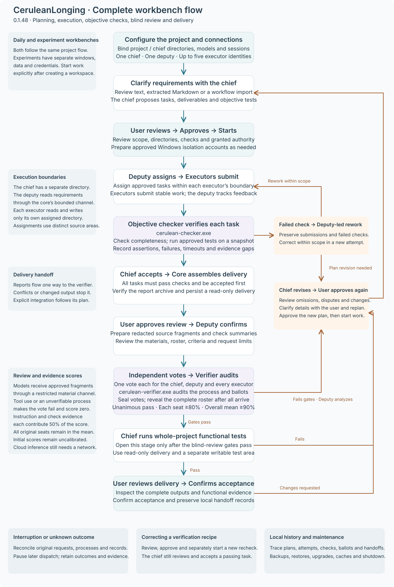
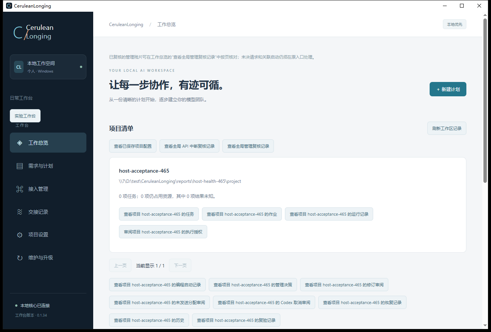
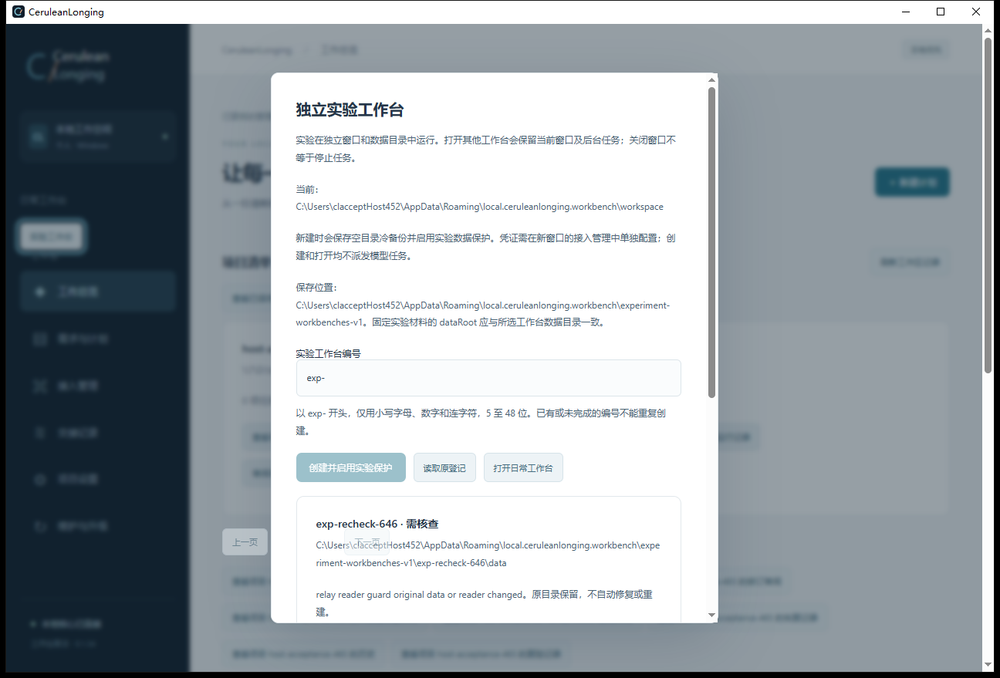
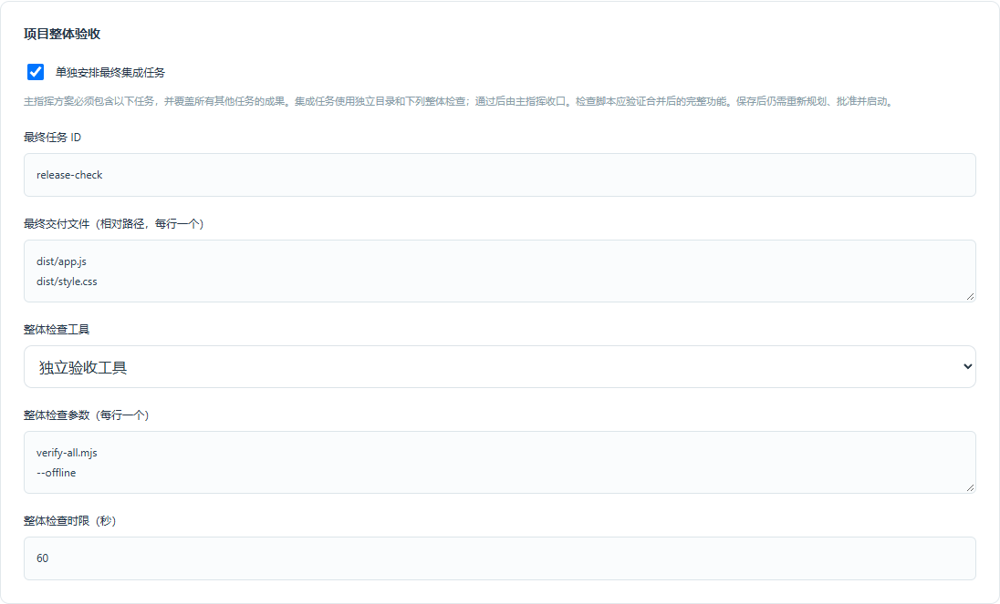
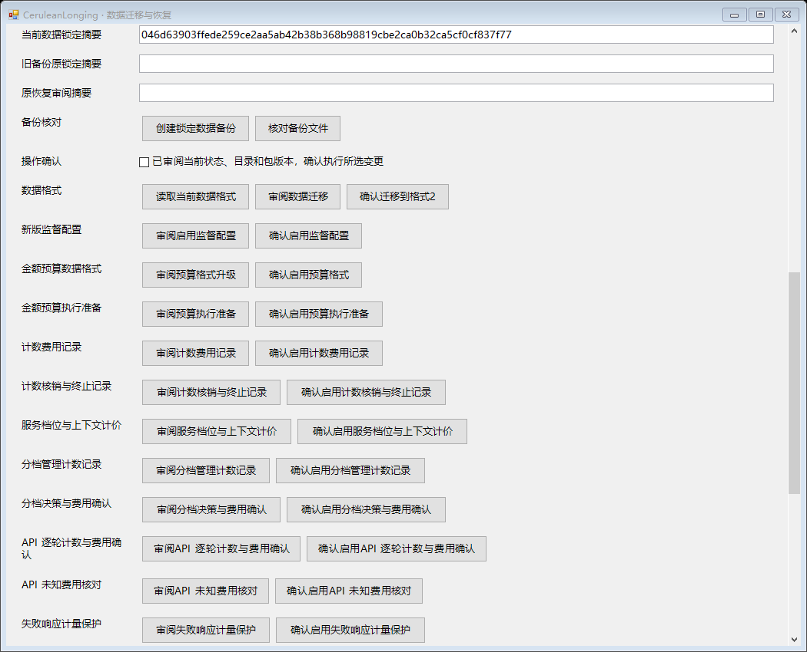

# CeruleanLonging

**让每一步协作，有迹可循。**  

**Make every step of AI collaboration traceable.**

[简体中文](#zh) · [English](#en) · [版本更新](#changelog-zh) / [Changelog](#changelog-en) · [界面预览 / Screenshots](#screenshots) · [项目反馈 / Feedback](#feedback)

发布者 / Publisher：**lantu**  

平台 / Platform：**Windows x64**  

阶段 / Stage：**公开预览 · Public Preview**

## 简体中文

### 项目介绍

CeruleanLonging 是一款面向 Windows 的本地优先多模型协作工作台，将需求整理、方案规划、任务分配、编程执行、结果验证和交接记录组织在同一个项目流程中。

它面向需要持续推进实际交付的 AI 辅助开发场景：用户确定目标与边界，模型和工具承担不同职责，工作台记录过程、产物与检查结果。你可以围绕自己的项目目录组织工作，了解每项任务由谁执行、依据什么方案推进、结果是否经过检查，以及中断后还有哪些事项需要处理。

产品希望让 AI 协作成为可审阅、可接续的工作过程。无论是完成一个独立功能、修改已有代码，还是安排多个相关任务，需求、授权和交付依据都应能够串联起来。

### 产品特色

**分角色协作，围绕共同交付目标组织工作。** 主指挥负责方案与收口，副指挥负责分配与协调，执行者完成具体任务，独立验收工具检查结果。不同角色可以按受支持的接入方式配置，让规划、执行和验证各有明确职责。

**批准对应具体方案。** 项目需求、执行范围、产物和检查方式在执行前形成可审阅的配置与方案。用户能够了解即将授权的工作；配置或方案发生变化时，需要重新核对对应的执行依据。

**把验证放进交付流程。** 可以为任务登记独立检查工具和交付文件，也可以配置最终集成任务，对合并后的成果做整体检查。执行者的完成报告与实际检查结果分别记录，便于判断任务是否真正满足约定要求。

**检查方式可修订，原交付有据可查。** 当验收脚本或检查参数需要更正时，可以为原提交审阅并批准一次新的复验。原失败记录与交付文件保留，批准和启动分别操作；复验通过后仍需主指挥核对交付结果。

**角色与工作目录隔离。** 主指挥需求单独保存，副指挥通过核心提供的只读入口核对。副指挥与执行端共用的总目录内，最多保留五个执行身份的固定子目录；模型可替换，已登记身份复用自己的目录。API 文件工具限定访问范围，CLI、桌面执行及新隔离任务的客观检查使用绑定的普通 Windows 账户。

**项目盲评，各席独立作出判断。** 任务客观检查和主指挥接受之后，用户审阅脱敏、分片后的完整交付材料与参评名单。副指挥确认就绪，主副指挥及各执行身份每席投一票；收齐后统一揭晓，全票通过仍须用户确认。首版仅支持无工具 API 评审，会话不提供文件工具、总分或他人投票。脱敏和分片不能保证消除任意暗号；盲评也不替代客观检查。

**实验有独立的工作空间。** 实验工作台使用单独的窗口和数据目录，方便试用配置或验证流程。凭证按工作台分别配置，创建实验本身不会派发模型任务。

**用本地工作流复用协作方法。** 可以导入带版本号的工作流模板，预览步骤依赖、完成标准与副指挥监督要点，再填入需求草稿。可按不同任务类型复用流程，模型、工具与执行权限仍由项目配置和批准方案决定。

**用项目记录延续上下文。** 计划、管理决定、任务尝试、检查结果和交接信息保存在本机。重新打开工作台后，可以继续查看原项目的记录，明确已完成的工作与待处理事项，减少跨轮次协作时重复整理背景的负担。

**异常状态也有记录。** 对失败、中断或结果未知的操作，工作台保留原记录，并提供相应的审阅和处置入口。恢复时先核对已有状态；未知请求不会被当作未发生而自动重新发送。

**兼顾日常使用与数据维护。** 桌面界面连接独立本地核心，项目记录的生命周期不依赖单个窗口。产品提供备份核对、数据恢复和升级维护入口，帮助用户在维护前了解当前状态并审阅变更。

### 主要功能

| 功能区域 | 可以用来做什么 |
| --- | --- |
| 工作总览 | 查看项目清单、目录和状态摘要；详细项目记录保留在后台。 |
| 需求与计划 | 整理目标，配置角色、产物和验收方式，审阅方案并启动已批准的工作。 |
| 接入管理 | 管理模型服务和执行工具的配置，核对连接状态及可用能力。 |
| 执行与监督 | 查看任务进展、检查结果和需要关注的状态，暂停后续调度并处理异常。 |
| 复验审阅 | 针对原提交修订检查器，审阅并单独批准复验，核对原结果或保留证据结束复验。 |
| 项目盲评 | 审阅材料与参评名单，批准独立投票，查看完整结果并确认交付或提出修订。 |
| 实验工作台 | 在独立窗口与数据目录中组织实验，保留日常工作台的项目记录。 |
| 交接与历史 | 回看协作过程和决策依据，接续需要跨多轮处理的任务。 |
| 项目设置 | 管理项目目录、执行者、资源和整体交付检查等配置。 |
| 维护与升级 | 核对备份，审阅数据迁移与恢复操作，维护程序和项目数据。 |

### 完整工作流程（0.1.48 预览）

图示对应 0.1.48 预览版工作流程。独立检查逐任务核对交付完整性与批准测试，全部合格并接受后汇总只读交付，再进入整体盲评、主指挥功能测试与用户最终确认。

[查看中文原图](docs/images/workflow-0.1.48-zh.svg) · [View the English diagram](docs/images/workflow-0.1.48-en.svg)

### 接入与本地数据

项目覆盖模型 API、编程工具和桌面工具等不同接入方向，包括 Codex、OMP、Qoder，以及 OpenAI、Claude、DeepSeek、Qwen、Kimi、Grok 等模型服务相关路线。**各路线的角色支持、自动化能力和验证程度不同，列入范围不代表当前版本全部可用。** 请以当前版本的接入页面与说明为准。

本地优先意味着项目管理记录和工作状态主要保存在自己的电脑上。使用在线模型时，仍会按任务配置向对应服务发送请求及所需上下文，费用由相应服务计收；本地优先不等于全部离线。

暂停后续调度不等于撤销已发出的远端请求。请求次数或执行时限也不等于费用封顶。多模型协作的质量、用量和耗时取决于任务及配置，项目不承诺固定的 token 节省比例；角色协调与结果核对也可能增加用量和总耗时。

编程 API 的每轮输出长度可以按所选模型配置，实际输出仍受供应商上限和本次尝试剩余 token 预算约束。

金额预算配置目前可保存供审阅，尚不能用于启动执行。运行中异常监督按接入能力开放：Codex、OMP 和 API 的反馈有各自的确认状态；现有外部桌面接入暂不提供运行中严格监督保证。

### 实现概述

产品使用 Tauri、React / TypeScript 构建桌面界面，以独立 Rust 核心管理项目状态、执行流程与本地记录，通过适配层连接模型服务和执行工具。桌面与命令行共享核心能力，持久化记录支持历史追溯、状态核对与恢复。

### 当前阶段

**当前版本为 0.1.48 公开预览候选**，补齐逐执行端独立检查、只读交付汇总、整体盲评及主指挥功能测试的衔接，完善桌面升级适配、需求导入和接入配置。详见支持范围和版本说明。[支持范围](SUPPORT.md) · [版本说明](docs/releases/0.1.48.md)

可在独立实验工作台试用完整流程，并在方案批准前配置检查账户。升级前请通过维护页备份。新检查材料需要 reader24，绑定 API 执行端评审输出额度的轮次需要 reader25。本版支持这些数据代际。

0.1.48 安装包正在进行最终云端检查，发布后将在这里提供下载入口。历史安装包与源码包可在已发布版本中下载。[已发布版本](https://github.com/CereleanLonging/CeruleanLonging/releases)

自有代码采用 [MIT 许可证](LICENSE)，第三方组件保留各自许可证。

### 版本更新记录

按新到旧排列，日期采用北京时间（UTC+8）。完整说明与下载附件以各版本发布页为准。

#### 0.1.48 · 2026-11-08 · 公开预览候选

安装包正在进行最终云端检查。以下更新说明包含本次已确认的界面改动，发布后补充下载入口。

更新柔蓝主题与品牌标识，日常工作台和独立实验台采用浅深两套配色。表单、按钮与退出弹窗统一样式，支持键盘焦点和减少动画，切换页面后自动回到顶部。

主页新增可滚动、放大的完整流程图，README 提供中英文版本，包含逐任务检查、整体盲评、主指挥功能测试与返工修订回路。

独立检查逐一核验各执行端交付，失败结果返回副指挥安排返工。全部合格并接受后，核心汇总只读交付与报告，再进入独立盲评和主指挥整体功能测试。盲评材料附带独立验收进程生成的匿名检查事实，新材料启用 reader24。API 执行端评审沿用已批准的输出额度，逐席展示并绑定本轮批准摘要，相应轮次启用 reader25。

桌面升级后会重新核验程序与会话身份。Codex 原路径消失时扫描可用程序，候选歧义需要明确选择；Qoder 同协议候选版本先完成固定消息验证，再重新绑定。日常工作台和独立实验台分别采用浅色、深色侧栏。接入页的“下一步”统一执行检查、保存与弹窗确认。

Markdown 导入绑定工作台内置的本地提炼工具，无需主指挥配置或 Key；按文档结构整理内容，保留原文与行号，审阅确认后才读入草稿。项目需求、工作流和 Markdown 导入合为一个输入框，左下角“＋”导入工作流 JSON，回形针导入 `.md`，预览与确认按需弹出。

需求框支持拖入单个 `.md` 或工作流 `.json` 文件，预览确认后读入草稿。请求主指挥按钮会说明配置待保存、凭证缺失等具体原因。主窗口保持管理员权限；“打开拖拽导入窗口”启动当前账户的普通权限文件窗口，校验文件后返回主窗口预览确认。

项目盲评按已保存目录自动生成默认脱敏规则，支持自定义精确替换；规则按项目在本次应用会话中保留，修改后需重新准备并审阅材料。移除需求与计划页重复的监督、检查与验收绑定卡片，工具入口统一保留在项目设置；后台监督及检查权限保持，检查时限并入执行限制。项目执行方案、历史费用和费用核对归入默认折叠的“项目数据与费用统计”，位于盲评与请求记录之间。本轮真实服务合成项目实验已完成独立检查、四席盲评、主指挥功能测试及测试交付确认。回归结果与实际覆盖范围见本版说明。[版本说明](docs/releases/0.1.48.md)

#### 0.1.44 · 2026-11-04 · 公开预览

源码缓存进入临时目录，受管构建与测试结束后自动清理并保留空目录。维护页增加缓存扫描、累计监控与清理入口，提炼日志保存到独立文档目录。同步改善接入持久化、折叠选择和维护布局。

[版本说明](docs/releases/0.1.44.md)

#### 0.1.43 · 2026-11-03 · 公开预览

简化工作总览，项目任务、作业、运行、配置及管理审阅等详细记录入口收回后台，保留项目清单和状态摘要；原记录与受限查询能力继续保留。正常的需求规划、方案审批、执行与验收流程不变，交接页及维护只读日志仍可使用。退出确认改用顶层模态窗口，修复“上一页／下一页”穿透遮罩的问题，并阻止底层鼠标与键盘操作；Esc 走原取消流程，停止后台期间不能绕过等待。

[版本说明](docs/releases/0.1.43.md)

#### 0.1.42 · 2026-11-03 · 公开预览

- “独立实验工作台”单列在维护页上方，默认关闭，勾选后集中展开工作台管理及团队／单执行者效率实验。开启不自动创建或执行实验。
- API 中断与管理复核记录移入“维护与升级 → 只读日志”，在独立窗口内分类查看；工作总览不再显示这两个入口。
- 日志窗口仅可读取这两类记录，保留分页、原身份与过期校验；重复打开复用窗口，关闭日志不停止任务，退出工作台时一并关闭。
- 日志刷新不自动启动或重启核心，不改变原记录、项目配置或数据格式。

[版本说明](docs/releases/0.1.42.md)

#### 0.1.41 · 2026-11-03 · 公开预览

- 审阅方案时可明确授权创建普通隔离账户、设置项目目录权限，默认关闭；授权绑定方案、配置、目录和固定脚本。
- 已有管理员权限时直接准备，否则由 Windows 请求一次 UAC。取消、失败、重复批准和重开不会自动重弹；模型登录和任务启动仍单独进行。
- 首次使用此授权启用 reader20 数据保护，之后需使用 0.1.41 或更新的兼容版本；未勾选时保持原批准格式。

[版本说明](docs/releases/0.1.41.md)

#### 0.1.40 · 2026-11-03 · 公开预览

- 正常执行强制绑定各模型的独立目录；旧未隔离方案仍可查看和核对，但需重新规划、批准后才能派发。
- 主指挥规划和副指挥分配上下文明确模型身份、目录、负责文件及评审边界；不同执行端声明同一文件、大小写别名或父子重叠路径时拒绝方案。
- 评审仍只接收核心转交、独立验收工具处理的批准源码片段，不开放全库读取、文件工具、其他投票或总分。

[版本说明](docs/releases/0.1.40.md)

#### 0.1.39 · 2026-11-03 · 公开预览

- 新增随工作台分发的独立验收程序，固定绑定并核对摘要，实际承担脱敏分片、核票和全票判定；项目客观测试与最终用户确认保持。项目专用检查配置收进高级设置。
- 编程项目初始目录为 `D:\test\coding`，可自行修改；验收工具留在工作台程序目录，不迁移已关联项目。
- 主指挥桌面接入不再因尚无项目而直接禁用；先引导关联目录，再保留“当前 Codex 聊天”的选择并定位到绑定字段。配置仍需手动保存。
- 修复配置跳转在读取完成前丢失定位的问题；重访已有绑定时保留会话标识和其他角色，离开页面会取消未完成的跳转意图。
- 退出按钮更紧凑，并与版本号保持间距；文档提炼项目列表补充配置入口及空状态说明。自动提炼仍需 API 主指挥。
- Windows 程序需与配套核心及资源放在一起；桌面请使用指向完整目录的快捷方式。

[版本说明](docs/releases/0.1.39.md) · [发布页与下载](https://github.com/CereleanLonging/CeruleanLonging/releases/tag/v0.1.39)

#### 0.1.38 · 2026-11-03 · 公开预览

- `.md` 导入由已保存的 API 主指挥自动提炼，展示可编辑结果、原文与引用；确认后才替换草稿，保存、批准与启动各自独立。
- 取消固定文件、正文和手工记录条数上限；长文档分段处理，仍受本机资源及项目调用额度约束。选择文档可能产生模型调用费用，失败不自动重发。
- 切换项目或修改配置、草稿会使旧结果失效；修复导入计划保存后旧任务缓存影响下一份手工计划的问题。

[版本说明](docs/releases/0.1.38.md) · [发布页与下载](https://github.com/CereleanLonging/CeruleanLonging/releases/tag/v0.1.38)

#### 0.1.37 · 2026-11-03 · 公开预览

- 关闭窗口先确认，再停止当前工作台后台核心并核实退出；停止失败或仍有未决任务时保留窗口，退出过程中的刷新不会重新拉起核心。
- 创建计划和项目需求新增本地 `.md` 导入：预览后确认填入，保存、规划与批准仍单独操作；其他文档格式不支持。
- 导入只读取 UTF-8 文本，不执行 Markdown／HTML 或加载外部链接；超限拒绝，不静默截断。

[版本说明](docs/releases/0.1.37.md) · [发布页与下载](https://github.com/CereleanLonging/CeruleanLonging/releases/tag/v0.1.37)

#### 0.1.36 · 2026-11-03 · 公开预览

- 主指挥、副指挥和执行端各有独立标题；API、Key、CLI 与桌面接入按当前角色能力分类折叠，主指挥先选方式再显示单一配置入口。
- 项目模型配置按角色分区；扫描按钮紧邻 Codex 路径，登录检查放在下一行，仅需要程序路径的已支持入口显示扫描。
- 接入管理新增“扫描本地 Codex”，查找运行中的程序、PATH 和常见安装目录；确认候选路径后，单独进行登录检查。
- 区分安装文件夹、桌面启动程序与命令行程序，提供明确的中文路径提示。
- 工作台通用报错增加中文说明和可展开的原始技术详情，保留原错误记录及结果未知提示。

[版本说明](docs/releases/0.1.36.md) · [发布页与下载](https://github.com/CereleanLonging/CeruleanLonging/releases/tag/v0.1.36)

#### 0.1.35 · 2026-11-03 · 公开预览

- **角色与执行目录隔离：** 主指挥需求单独保存，副指挥只读核对；执行身份使用各自固定子目录，上限五个，支持模型替换与目录复用。新隔离任务的 CLI、桌面执行和客观检查使用绑定的普通 Windows 账户。
- **项目级 API 盲评：** 审阅并批准脱敏分片材料后，主副指挥及各执行身份独立投票，收齐后统一揭晓，全票通过仍需用户确认。首版仅支持无工具 API 评审，保留客观检查和主指挥接受环节。
- **调度修复：** 修正并行调度将旧方案的失败检查错误关联到新尝试的问题，保留历史记录及当前失败的阻断。
- **备份兼容修复：** 补齐 0.1.35 的备份写入版本声明，确保新版能够识别本版生成的备份。
- **接入调整：** 移除 WorkBuddy 新接入与执行支持，保留既有历史记录。

升级前请备份；启用盲评后的数据要求 reader19，旧核心不能读取。新盲评机制的模型回包验证使用合成数据，尚无新增真实供应商质量结论。

[版本说明](docs/releases/0.1.35.md) · [发布页与下载](https://github.com/CereleanLonging/CeruleanLonging/releases/tag/v0.1.35)

#### 0.1.34 · 2026-11-02 · 公开预览

- **公开预览基线：** 完成当时约定范围的功能验收，开放 Windows x64 安装包与源码，项目自有代码采用 MIT 许可。
- **协作与验证：** 提供需求规划、分角色执行、独立检查、原提交复验及交接记录。
- **实验与维护：** 支持独立实验工作台、本地工作流导入，以及备份、恢复和升级维护。

[发布页与下载](https://github.com/CereleanLonging/CeruleanLonging/releases/tag/v0.1.34)

更早的 0.1.30、0.1.32、0.1.33 及 0.1.34 内部候选保留在[历史发布记录](https://github.com/CereleanLonging/CeruleanLonging/releases)中，属于开发阶段记录。

---

## English

### About the project

CeruleanLonging is a local-first, multi-model collaboration workbench for Windows. It brings requirements, planning, task assignment, coding, verification, and handoff records into a shared project workflow.

It is designed for AI-assisted development that needs to produce concrete deliverables over multiple sessions. You define the goal and boundaries, models and tools take on distinct responsibilities, and the workbench records actions, artifacts, and check results. Working with your own project directory, you can see who performed a task, which plan authorized it, whether its output was checked, and what needs attention after an interruption.

The aim is to make AI collaboration reviewable and resumable. Whether you are implementing a feature, changing existing code, or organizing related tasks, requirements, authorization, and delivery evidence should remain connected.

### What makes it distinctive

**Distinct roles working toward a shared deliverable.** A lead planner handles planning and final review, a coordinator assigns work, workers perform tasks, and independent verification tools check results. Supported integrations let you configure these roles with clear responsibilities for planning, execution, and verification.

**Approval tied to a specific plan.** Requirements, execution scope, artifacts, and checks form a reviewable configuration and plan before work starts. You can understand what you are authorizing; changes to the configuration or plan require the corresponding execution basis to be reviewed again.

**Verification built into delivery.** Register independent checks and expected files for tasks, and configure a final integration task to check the combined result. A worker's completion report and the actual verification results are recorded separately, helping you assess whether the agreed requirements were met.

**Revised checks with traceable original delivery.** If a validation script or its arguments need correction, you can review and approve a new check of the original submission. The original failure and delivered files are retained, approval and execution are separate actions, and a successful check still requires the lead planner's delivery review.

**Separate role and worker directories.** Lead-planner requirements are stored separately and exposed to the coordinator through a core-controlled read-only interface. The shared coordinator/worker root holds up to five fixed worker-identity directories. Models can be replaced, while registered identities reuse their directories. API file tools enforce scope; CLI and desktop execution and objective checks for new isolated tasks use bound standard Windows accounts.

**Independent votes for project review.** After objective checks and lead acceptance, you review the redacted, fragmented delivery material and full reviewer roster. The coordinator confirms readiness, then the lead, coordinator, and each worker identity cast one vote. Results are revealed together; unanimous approval still requires your confirmation. This first version supports tool-free API review only, without file tools, totals, or other reviewers' votes. Redaction and fragmentation cannot guarantee removal of arbitrary covert signals, and voting does not replace objective checks.

**Separate spaces for experiments.** Experiment workbenches use their own windows and data directories for trying configurations or validating workflows. Credentials are configured separately for each workbench, and creating an experiment does not dispatch a model task.

**Reusable collaboration through local workflows.** Import a versioned workflow template, preview its step dependencies, completion criteria, and coordinator guidance, then apply it to a requirements draft. Templates can support different task types; models, tools, and execution authority remain governed by the project configuration and approved plan.

**Project records that carry context forward.** Plans, management decisions, task attempts, check results, and handoff information are stored locally. Reopening the workbench lets you inspect the original project's records and distinguish completed work from outstanding issues, reducing the need to reconstruct context between sessions.

**Visible records of exceptional states.** Failed, interrupted, or unresolved operations retain their records and have corresponding review and resolution paths. Recovery starts by reconciling existing state; an unknown request is not automatically resent as if it never happened.

**Support for everyday work and data maintenance.** The desktop interface connects to an independent local core, so project records are not tied to the lifetime of one window. Backup verification, data recovery, and upgrade maintenance interfaces help you review the current state and proposed changes.

### Main features

| Area | What it helps you do |
| --- | --- |
| Overview | View project directories and status summaries; detailed project records remain in the backend. |
| Requirements and plans | Define goals, roles, artifacts, and checks; review plans and start approved work. |
| Integrations | Configure model services and execution tools, and inspect connection status and capabilities. |
| Execution and supervision | Follow progress and check results, pause further scheduling, and resolve issues. |
| Recheck review | Revise checks for an original submission, approve a recheck separately, and reconcile its result or close it while retaining evidence. |
| Project blind review | Review materials and the roster, authorize independent voting, inspect complete results, and confirm delivery or request a revision. |
| Experiment workbenches | Organize experiments in separate windows and data directories while retaining everyday project records. |
| Handoffs and history | Review collaboration records and decisions, and continue work across sessions. |
| Project settings | Configure project directories, workers, resources, and final delivery checks. |
| Maintenance and upgrades | Verify backups and review migration, recovery, and program maintenance operations. |

### Complete workflow (0.1.48 preview)

The diagram describes the 0.1.48 preview workflow. Independent checks evaluate each task's completeness and approved tests. After all tasks pass and are accepted, the core assembles read-only delivery for blind review, chief functional testing and final user confirmation.

[View the English diagram](docs/images/workflow-0.1.48-en.svg) · [查看中文原图](docs/images/workflow-0.1.48-zh.svg)

### Integrations and local data

The project's integration scope includes model APIs, coding tools, and desktop tools: Codex, OMP, Qoder, and routes involving services such as OpenAI, Claude, DeepSeek, Qwen, Kimi, and Grok. **Supported roles, automation capabilities, and validation coverage vary by route. Inclusion in this scope does not mean that every route is available in the current version.** Refer to the current integration interface and documentation.

Local-first means that project management records and working state primarily reside on your computer. Online models still receive requests and the context required by the configured task, and the corresponding services charge for their usage. Local-first does not mean fully offline.

Pausing further scheduling does not revoke requests already sent to a remote service. Request counts and execution deadlines are not spending caps. Quality, usage, and elapsed time depend on the task and configuration; the project does not promise a fixed percentage of token savings. Role coordination and result review can also increase usage and total elapsed time.

Per-request output length for coding APIs can be configured for the selected model. Actual output remains subject to the provider’s limit and the remaining token budget for the attempt.

Currency-budget configurations can currently be saved for review but cannot start execution. Runtime supervision depends on the integration: Codex, OMP, and API feedback have distinct confirmation states; existing external desktop integrations do not yet provide a strict runtime-supervision guarantee.

### Implementation overview

The desktop interface uses Tauri and React / TypeScript. An independent Rust core manages project state, execution, and local records, while adapters connect model services and execution tools. The desktop and command-line interfaces share core capabilities, with persistent records supporting history, reconciliation, and recovery.

### Current stage

**The current version is the 0.1.48 public preview candidate** connecting per-executor checks, read-only delivery assembly, whole-project blind review and chief functional testing. It also improves desktop upgrade handling, requirement imports and connection configuration. [Support scope](SUPPORT.md) · [Release notes](docs/releases/0.1.48.md)

Use a separate experiment workbench to try the workflow and prepare checking accounts before approving the plan. Back up through Maintenance before upgrading. New check material requires reader24, and rounds with configured API executor review limits require reader25. This release supports both generations.

The 0.1.48 installer is undergoing final cloud checks. Its download link will be added here after publication. Earlier installers and source packages are available from published releases. [Published releases](https://github.com/CereleanLonging/CeruleanLonging/releases)

Original project code is licensed under [MIT](LICENSE); third-party components retain their own licenses.

### Changelog

Newest first. Dates use Beijing time (UTC+8). See each release page for full notes and downloads.

#### 0.1.48 · 2026-11-08 · Public preview candidate

The installer is undergoing final cloud checks. These notes include the approved UI changes. Download links will be added when the release is published.

The refreshed blue theme and brand mark use light and dark palettes for daily and experiment workbenches. Forms, buttons and exit dialogs share consistent styling, with keyboard focus, reduced-motion support and scroll reset when changing pages.

The home page gains a scrollable, enlarged workflow view, with matching Chinese and English README diagrams covering per-task checks, blind review, chief functional testing, rework and revisions.

The independent checker validates each executor’s complete delivery and approved tests. Failures return to deputy-directed correction. After every result passes and is accepted, the core assembles a read-only delivery and reports for blind review, followed by the chief’s whole-project functional test. Review material includes anonymous facts produced by the independent verifier and enables reader24. API executor reviews use the approved output allowance, displayed per seat and bound to the round approval digest. These rounds enable reader25.

A live-service experiment using a synthetic project completed independent checks, four-seat blind review, chief functional testing and test delivery confirmation. Validation scope and earlier attempts are documented in the release notes. [Release notes](docs/releases/0.1.48.md)

Desktop upgrades trigger executable and session identity checks. Codex can rediscover a missing executable, with explicit selection for ambiguous candidates. Qoder candidates in the supported protocol family require a fixed-message check and a fresh binding. Daily and experiment workbenches use light and dark sidebars. Next on the connection page now checks, saves and requests confirmation in one flow.

Markdown import uses a built-in offline extraction tool with no chief configuration or API key required. It organizes document structure, retains source text and line references, and applies drafts only after review. Requirements and both import controls share one composer: the lower-left plus imports workflow JSON and the paperclip imports `.md`, with previews shown on demand.

Drop one `.md` or workflow `.json` file into the requirements field to review and import it. The plan request button explains pending configuration saves and missing credentials. The main window keeps administrator privileges. “Open drag-and-drop import window” launches a separate standard-privilege picker under the current account, verifies the file, and returns it to the main window for review and confirmation.

Blind review generates directory redactions from saved project settings and accepts custom exact replacements. Drafts remain project-scoped for the current app session; changes require preparing and reviewing material again. Duplicate supervision, checker and verifier binding cards are removed from planning. Project settings retain the tool entry points; supervision and verification permissions remain, with check timeouts alongside execution limits. Execution plans and fee records now share a default-collapsed statistics group between blind review and management request history. See this version’s notes for local validation and publication status.

#### 0.1.44 · 2026-11-04 · Public Preview

Source caches use temporary job directories and are cleaned after managed builds/tests while empty directories remain. Maintenance adds cache scans, cumulative monitoring and cleanup with distilled local receipts. Connection persistence, collapsed methods and maintenance layout are also refined.

[Release notes](docs/releases/0.1.44.md)

#### 0.1.43 · 2026-11-03 · Public Preview

Simplifies the overview by removing detailed task, job, run, configuration and management-review record links, retaining project summaries and status. Original records and bounded backend queries remain available. Planning, approval, execution and verification flows are unchanged, as are handoff history and maintenance logs. Exit confirmation now uses a top-layer modal dialog so pagination cannot appear above its backdrop or receive mouse or keyboard input. Escape follows the existing cancel flow and cannot bypass a pending backend stop.

[Release notes](docs/releases/0.1.43.md)

#### 0.1.42 · 2026-11-03 · Public Preview

- A dedicated experiment page above Maintenance defaults to off. Opting in reveals workbench management and both efficiency experiments without creating or executing experiments automatically.
- API interruption and management review records now live in a separate window under Maintenance & Upgrade → Read-only Logs, with category tabs instead of overview buttons.
- The window can read only those records, retaining pagination, original identities and stale-result checks. Reopening focuses the existing window; closing logs leaves tasks running, while exiting the owner closes its logs.
- Log refresh never starts or restarts the core, and changes no records, project configuration or data format.

[Release notes](docs/releases/0.1.42.md)

#### 0.1.41 · 2026-11-03 · Public Preview

- Plan review can explicitly authorize ordinary isolated accounts and project ACL preparation. Default off; bound to the plan, configuration, directories and fixed script.
- An elevated host uses its existing token; otherwise Windows asks for one UAC consent. Cancellation, failure, duplicate approval and reopening never automatically repeat it. Model login and task start remain separate.
- First use enables reader20 data protection, requiring 0.1.41 or a newer compatible reader. Unchecked approvals retain their original format.

[Release notes](docs/releases/0.1.41.md)

#### 0.1.40 · 2026-11-03 · Public Preview

- Normal dispatch requires a bound directory for every worker model. Legacy unisolated plans remain readable and reconcilable, but require replanning and approval before dispatch.
- Lead planning and coordinator assignment contexts state model identities, directories, owned files and review boundaries. Plans are rejected when distinct workers declare the same file, case aliases or overlapping parent/child paths.
- Review still receives only approved source fragments prepared by the independent verifier and delivered through the core, without repository access, file tools, other votes or totals.

[Release notes](docs/releases/0.1.40.md)

#### 0.1.39 · 2026-11-03 · Public Preview

- A separately executed verifier ships with the workbench, with a fixed, hash-checked binding. It prepares redacted fragments, validates ballots and checks unanimity; objective project tests and final user confirmation remain. Project-specific checking tools are advanced settings.
- Project registration starts at `D:\test\coding` and remains editable. The verifier stays in the program directory; existing projects are not relocated.
- Desktop-chief setup remains actionable before a project exists: register a directory, then continue with Current Codex Chat selected and its binding fields focused. Saving remains explicit.
- Configuration navigation waits for loaded data, preserves an existing session and other roles, and discards unfinished navigation intent when leaving the page.
- The exit control is smaller with space below the version. Document refinement has a styled project selector, empty-state guidance and a configuration entry; automatic refinement still requires an API chief.
- Keep the Windows GUI, runtime and bundled resources together; use a desktop shortcut to the complete directory.

[Release notes](docs/releases/0.1.39.md) · [Release and downloads](https://github.com/CereleanLonging/CeruleanLonging/releases/tag/v0.1.39)

#### 0.1.38 · 2026-11-03 · Public Preview

- The saved API chief automatically refines imported `.md` files. Editable results, original text and citations are reviewed before confirmation replaces the draft; saving, approval and execution remain separate.
- Fixed file/text/manual-record import limits have been removed. Long documents use segmented processing, subject to local resources and project request budgets. Selecting a document may incur model charges; failed calls are not automatically resent.
- Project, configuration and draft changes invalidate earlier results. Imported task state is cleared after saving so it cannot affect the next manual plan.

[Release notes](docs/releases/0.1.38.md) · [Release and downloads](https://github.com/CereleanLonging/CeruleanLonging/releases/tag/v0.1.38)

#### 0.1.37 · 2026-11-03 · Public Preview

- Window exit now requires confirmation, stops the associated core, and verifies its exit. Unresolved tasks or a failed stop keep the window open; refreshes cannot restart the core during shutdown.
- Create Plan and project requirements accept local `.md` files with preview and explicit import confirmation. Saving, planning, and approval remain separate actions; other document formats are unsupported.
- Import reads UTF-8 text without executing Markdown/HTML or loading external links. Oversized content is rejected rather than silently truncated.

[Release notes](docs/releases/0.1.37.md) · [Release and downloads](https://github.com/CereleanLonging/CeruleanLonging/releases/tag/v0.1.37)

#### 0.1.36 · 2026-11-03 · Public Preview

- Chief, deputy, and workers have separate headings. API, Key, CLI, and desktop entries are grouped by supported role capabilities; the chief uses one entry selected by connection method.
- Project model settings are separated by role. Codex discovery sits beside the executable path, with login checking on the next row; scanning appears only for supported entries that require a program path.
- Added local Codex discovery in Integrations, covering running programs, PATH, and common installation directories. Select a candidate before explicitly checking login.
- Distinguishes installation folders, desktop launchers, and CLI executables, with actionable Chinese path messages.
- Added Chinese explanations and expandable original diagnostics to common workbench errors, retaining original records and unknown-result semantics.

[Release notes](docs/releases/0.1.36.md) · [Release and downloads](https://github.com/CereleanLonging/CeruleanLonging/releases/tag/v0.1.36)

#### 0.1.35 · 2026-11-03 · Public Preview

- **Role and worker directory isolation:** Lead-planner requirements are stored separately for read-only coordinator review. Worker identities use up to five fixed directories, with model replacement and directory reuse. CLI, desktop execution, and objective checks for new isolated tasks use bound standard Windows accounts.
- **Project-level API blind review:** After redacted, fragmented material is reviewed and approved, the lead, coordinator, and each worker identity vote independently. Results are revealed together, and unanimity still requires user confirmation. The first version supports tool-free API review, retaining objective checks and lead acceptance.
- **Scheduling fix:** Fixed parallel scheduling incorrectly associating an old plan's failed check with a new attempt, while retaining historical records and blocking on current failures.
- **Backup compatibility fix:** Added 0.1.35 to the supported backup-writer versions so the new core recognizes backups created by this version.
- **Integration change:** Removed new WorkBuddy integrations and execution support while retaining existing historical records.

Back up before upgrading. Enabling blind review requires reader19 data support; older cores cannot read that format. Validation of the new review mechanism uses synthetic model responses, with no new live-provider quality conclusion.

[Release notes](docs/releases/0.1.35.md) · [Release and downloads](https://github.com/CereleanLonging/CeruleanLonging/releases/tag/v0.1.35)

#### 0.1.34 · 2026-11-02 · Public Preview

- **Public-preview baseline:** Completed functional acceptance within the scope agreed at that time, with Windows x64 installer and source downloads and MIT licensing for original project code.
- **Collaboration and verification:** Provided requirements planning, role-based execution, independent checks, rechecks of original submissions, and handoff records.
- **Experiments and maintenance:** Supported separate experiment workbenches, local workflow imports, backup, recovery, and upgrade maintenance.

[Release and downloads](https://github.com/CereleanLonging/CeruleanLonging/releases/tag/v0.1.34)

Earlier internal candidates for 0.1.30, 0.1.32, 0.1.33, and 0.1.34 remain in the [release history](https://github.com/CereleanLonging/CeruleanLonging/releases) as development-stage records.

---

## 界面预览 / Screenshots

### 工作总览 / Project overview

0.1.34 历史安装版实测截图，不代表 0.1.35 新界面。展示项目入口与记录分类，图中的项目名和路径属于测试环境。

Historical screenshot from the installed 0.1.34 test build, not the new 0.1.35 UI. Shows project entry points and record categories; the project name and path belong to a test environment.

### 独立实验工作台 / Separate experiment workbench

0.1.34 历史安装版实测截图，展示实验工作台选择面板。示例目录和历史核查提示属于测试环境；创建与打开实验不会自动派发模型任务。

Historical screenshot from the installed 0.1.34 test build, showing the experiment selector. Example directories and historical review notices belong to the test environment; creating or opening an experiment does not automatically dispatch model tasks.

### 整体交付验收 / Final integration checks

开发阶段配置界面截图，展示最终集成任务、交付文件和独立检查工具的关联；字段为测试示例，不代表该示例项目已经完成。

Development-stage configuration screenshot showing how a final integration task links deliverables to independent checks. Field values are test examples, not evidence of a completed project.

### 数据迁移与恢复 / Data migration and recovery

开发阶段原生维护窗口截图，展示备份核对与数据格式变更的审阅入口。界面包含开发中的能力，不代表所有费用控制与恢复场景已完成验收。

Development-stage native maintenance window showing backup verification and review controls for data-format changes. Some capabilities are still under development; the image does not establish acceptance of every cost-control or recovery scenario.

## 项目反馈 / Feedback

[提交 Issue / Report an issue](https://github.com/CereleanLonging/CeruleanLonging/issues)

欢迎反馈使用体验、功能建议和问题。描述问题时，请附上产品版本、复现步骤，以及去除敏感信息后的截图或错误信息；请勿提交 API 密钥、登录凭证或私人项目内容。

Feedback, feature suggestions, and bug reports are welcome. Include the product version, reproduction steps, and screenshots or error messages with sensitive information removed. Do not share API keys, login credentials, or private project content.

项目随缘更新，也欢迎提交 Issue；会在有空时集中查看和处理。

Updates happen as time allows. Issues are welcome, and I’ll review and address them in batches when I have time.

发布者 / Publisher：**lantu**

## Code signing policy / 代码签名政策

当前安装包未签名，项目现阶段不申请代码签名。发布状态与校验说明见 [代码签名政策](CODE_SIGNING_POLICY.md)，数据和外部服务使用见 [隐私说明](PRIVACY.md)。

The current installer is unsigned; the project is not pursuing code signing at this stage. See the [Code signing policy](CODE_SIGNING_POLICY.md) for release status and verification details, and the [Privacy notice](PRIVACY.md) for data and external-service use.
