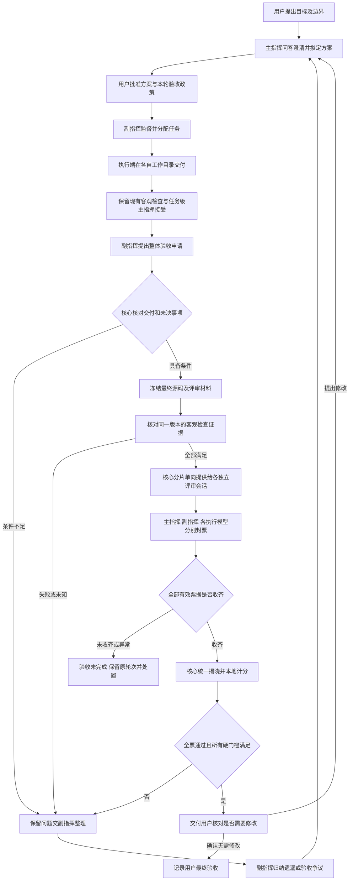
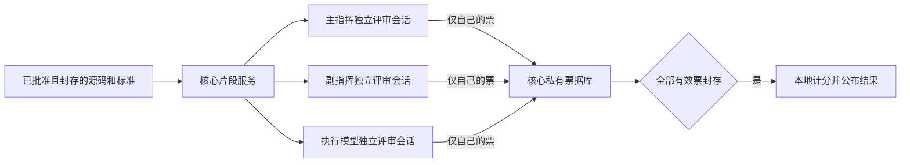

# 项目盲评验收机制可行性报告

日期：2026年11月3日。基于当前开发分支提交 `5d44642778fcafaa6a141f068dceb0b96e51d998`。本文为方案报告，尚未实现或启用盲评。

## 结论与已确定要求

方案有条件可行。建议将独立验收入口扩展为“客观检查与项目盲评”，保留现有检查程序、任务接受和历史证据，在项目执行结束后新增一次整体盲评及用户确认。不能直接用模型票数替换测试程序的真实检查结果，否则会与当前 `Verify → Accept` 规则冲突，也会失去对真实运行结果的核验。

用户已确定以下规则：

- 副指挥确认项目具备整体验收条件后，进入主指挥、副指挥及各执行模型的独立评审。
- 每个评审席位只有“通过”和“未通过”两个选择，各占一票；首版必须全票通过。
- 允许联网推理，但模型只能收到核心提供的、属于批准范围的源码片段，并提交自己的评价。核心不提供总分、他人投票、通用文件访问或模型间转发接口。
- 源码必须拆成小片段提供。发送前要阻断利用共享源码、附加文件或消息建立模型间交流通道的机会。
- 通过后交用户确认；用户要求修改时，由主指挥通过问答明确修订方向，形成新方案，再进入副指挥监督执行。
- 不通过时向副指挥公布结果，由其整理实现遗漏或验收争议，请求主指挥修订。主指挥在制定及修订方案时可以向用户提问。

**可强制保障的是本轮票据隔离、单向材料分发和禁止评审期间通过共享源码传话。不能保证开发者事先写入源码的所有隐含信号都能被识别，也不能让参与开发的模型忘掉自己的工作。** 本方案是结果互盲的独立评审，不宣称评审者不知道作者身份、没有先入判断或没有共同模型偏差。

## 与现有机制如何兼容

| 当前机制 | 直接替换的冲突 | 建议接法 |
| --- | --- | --- |
| 核心运行固定程序与脚本，核对退出状态、断言和证据后记录 `Verify` | 多数或全票不能证明测试真的通过 | 客观检查保留为硬门槛；投票不能覆盖失败、缺项或未知结果 |
| 普通协作模式下，已验证的任务由主指挥 `Accept` | 改由副指挥或投票直接接受任务会改变角色权限及账本语义 | 保留任务级接受；盲评新增为项目级最终验收，不反写旧任务结论 |
| 全部任务接受后，运行记录可变为 `Completed` | 当前“执行完成”不能直接等于“用户最终验收完成” | 保留运行账本原语义；另建项目验收状态，界面显示“执行已结束，待整体验收” |
| 执行端只能访问自己的绑定工作目录 | 给现有进程开放其他模型目录会破坏隔离 | 评审不授予实际仓库目录权限；由核心从封存副本提取只读片段，实现审查权限 |
| 主副指挥通过受控上下文读取资料 | 直接复用宿主权限会话或完整工作台快照可能暴露分数 | 建立独立评审会话与窄接口，不复用通用管理或宿主文件工具 |
| 模型目录最多五个，身份持久复用 | 每轮评审新建执行身份会耗尽目录额度 | 评审轮次不新建模型身份；会话临时资料不算新增执行模型目录 |
| 修订、纠正检查和启动各有用户授权边界 | 副指挥发现问题不等于有权批准新标准或自动重跑 | 副指挥提出修订建议；核心记录，用户批准新方案或复验后才执行 |
| 未知请求不自动重发，历史失败不覆盖 | 超时后换模型补票、不断重测直到全票会改变原评审 | 保留原轮次和未决状态；不得自行补票、缩小分母或覆盖失败 |

因此，“副指挥确认项目完成”在新流程中应表示**提交整体验收申请**，不是宣告项目已经通过。副指挥的申请也不是它的通过票；它仍需参加本轮独立投票。

## 建议工作流程

本图不表示每次重跑全部检查。对同一批准方案、同一封存字节且仍有效的原检查证据可以引用；只有新方案明确要求的新检查才执行新操作。已经失败或结果未知的检查沿用现有审阅、复验和恢复规则，不能借“进入盲评”自动重发。

项目源码分散在多个执行目录时，必须先明确最终集成目录及其清单。当前模型目录之间不会自动合并；不能把各目录简单拼接后称为完整可运行项目。需要集成任务时，由主指挥在方案中安排并经用户批准，然后对集成后的同一版本评审。

## 参评范围与计分

以用户批准的当前方案为准冻结参评名册：主指挥一席、副指挥一席，以及该方案选定的每个不同执行模型身份各一席。不是让工作台中所有历史登记模型或其他项目的模型都来投票。未实际分配到任务但属于本轮批准名册的模型仍要审查整体项目，不能因没有贡献而自动给通过票。

同一执行模型身份的多个任务或配置不重复计票；主、副指挥即使用同一底层模型，仍按用户规定分别占一个角色席位，但需单独会话，并在报告中披露这种相关性。相同模型、同一供应商或参与原开发不代表统计上的独立判断。

设执行模型数量为 `E`，本模式要求 `1 ≤ E ≤ 5`，总票数 `N = 2 + E`。通过计1，未通过计0，满分为N：

| 执行模型数 | 总票数 | 首版最低通过票数 |
| --- | --- | --- |
| 1 | 3 | 3 |
| 2 | 4 | 4 |
| 3 | 5 | 5 |
| 4 | 6 | 6 |
| 5 | 7 | 7 |

项目送交用户确认的条件为：**所有有效票据收齐，得分等于满分，客观检查通过，评审版本未变化，且没有未决执行、复验或评审操作。** 主指挥没有加权，副指挥没有改分权限；用户确认是最终决策，不作为额外一张模型票。

只有模型有效提交的选择才是票。超时、拒答、格式错误、身份不符、证据无法读取或调用结果未知，记为“该席位尚无有效票”，不是第三个评分选项，也不能自动当作通过或未通过。任一有效未通过票使全票条件不成立，但不提前把这个结果告诉尚未投票的模型，也不提前停止其他已批准评审。

模型更换、名单变化或验收标准调整后，必须形成新政策和新轮次，不能在本轮临时换掉未通过的模型。零执行者、缺少主副指挥的旧单执行者效率模式不自动套用本规则，也不能由核心冒充缺席模型投票。

## 源码分片与阻断交流通道

### 先封存，再拆片，再分发

核心在所有本轮评审开始前，封存最终源码、批准需求、验收条款、依赖清单及客观检查证据，生成内容摘要。封存前停止本版写入和调度，核对未决状态；封存后不吸收任何执行模型的新文件、评论、补丁或口头解释。写入新的代码只会形成下一版候选，不会悄悄改变正在评分的版本。

评审材料来自独立封存字节，不能是指向活动目录的符号链接、目录联接或共享可写硬链接。核心计票目录、工作日志、登录资料和评审暂存区始终在源码范围之外；不能把主副指挥目录、共享总目录或整个磁盘当作“整体仓库源码”开放。

### 分发前的脱敏与规范化

用户提出由独立验收工具先做脱敏，再把源码送给各模型。此做法可以清除部分显式交流内容、凭证和无关身份信息，适合作为分发前的防护层，但不能证明任意源码中不存在暗号。脱敏通常识别敏感信息，隐蔽通信检测则需要判断信息是否被用来传话，两者不是同一个问题。

建议新增由可信核心调用的材料处理步骤，与运行测试的检查程序分开记录职责；它不读取投票库，也不使用任何参评模型的票据作为输入。流程为：封存原源码 → 按固定政策检查及转换 → 复核材料完整性 → 生成分片 → 向独立评审会话分发。原源码及其客观检查证据保持不变。

| 处理对象 | 可以采取的处理 | 必须保留的限制 |
| --- | --- | --- |
| 凭证、个人信息、无关账号及会话标识 | 在批准范围内识别并遮蔽；发现真实凭证时停止外发并处理泄露风险 | 正则扫描不能保证发现所有秘密；脱敏不是允许随意外发源码的依据 |
| 无关聊天、投票提示、模型联络备注 | 从材料包排除或将该包标为待核对 | 如果该文本是产品提示词或测试输入，应作为待检查数据处理，不能删除后冒充完整覆盖 |
| 非语义空白、换行和普通注释 | 通过适用语言的解析器规范化或生成脱敏视图 | Python缩进、编译指令、类型检查指令、模板、SQL提示及工具约定注释可能有语义，不能通用删除 |
| 文件名、路径、变量名和作者身份 | 对确认无需原名的部分做一致的代号化，保留私有映射 | 模块导入、反射、序列化字段、公开API及动态访问可能依赖原名，不能无条件改名 |
| 常量、字符串、分支或算法结构 | 标记可疑内容并核对用途 | 任意修改可能改变功能、隐藏缺陷或破坏验收依据；不能以“更干净”为由删改 |

原源码快照摘要、脱敏视图摘要、处理政策版本、处理程序及规则摘要、变换清单必须绑定在同一轮次中。原名与代号的映射由核心私有保管；若原名可能包含通信信息，不能把映射又随片段发给模型。评语引用脱敏视图编号和位置，揭晓后由核心映射回原源码，供副指挥定位修改。

客观测试仍针对实际交付源码。模型投票的直接依据是脱敏视图，因此必须说明哪些内容经过变换、是否存在无法审查的部分；转换器不能仅凭解析成功或测试通过就声称与原程序完全等价。受变换影响的需求或审查项需要额外可信核验，无法覆盖时不得判定本轮验收完整。

首版宜使用可审计的固定规则和语言解析器，而不是让另一个大模型任意重写源码后代替原项目。后者既可能改变程序含义，也会引入新的材料污染来源，不能作为“绝对没有暗号”的证明。

有效防护来自多层共同约束：脱敏减少显式信号，投票前冻结阻止临时传话，受限接口阻断模型间转发，统一封票隐藏本轮选择。即使采用全部措施，仍应将结论限定为降低通信风险，不承诺消除所有预先约定的隐蔽信号。

### 片段协议

建议首版每片不超过8 KiB UTF-8且不超过120行，以先到者为准。这是待实现时测量调整的工程起点，不是模型上下文限制的替代。大文件必须拆片，小文件可能独立成片；任何接口都不提供整文件下载、压缩包或任意目录读取。

每片附核心生成的文件编号、规范相对路径、行范围、片段摘要和所属快照摘要。需求条款、文件清单和依赖关系也分页提供，不用一个超大请求把所有源码塞给模型。片段尽量沿函数或逻辑块拆分；超长逻辑块可以连续编号拆开，让模型核对相邻片段。小片段不意味着随机打乱到无法理解。

模型可以通过有限的 `read_review_fragment`、`list_review_manifest` 等专用操作请求同一封存版本内的片段。操作只接受核心发放的编号及有界分页参数，不接受本机路径、URL、shell命令或另一个模型的输出。不存在通用文件工具；模型提供的文字不能成为发给其他模型的材料。

所有参评者获得相同的批准需求、验收标准及可访问源码全集；片段读取顺序可以不同。核心记录实际提供的片段和覆盖情况。能够取得全库片段不等于已经读完，更不等于理解正确；必须要求按验收条款说明证据和审查范围。容量、费用或时间不够时记录缺口，不能声称已全面审查。

### 发送前的材料检查

| 内容或入口 | 处理原则 |
| --- | --- |
| 总分、票据、评审理由、模型聊天及派发日志 | 不进入源码快照及片段库；也不进入搜索索引、错误文本或管理摘要 |
| `.git` 内部数据、模型运行缓存、凭证、临时交流文件 | 从评审材料范围排除；保留排除清单，不能偷偷漏掉影响产品行为的源码 |
| `AGENTS.md`、模型提示文件、Issue文字、开发备注 | 作为潜在不可信内容处理；若是产品交付的一部分则仍须审查，但不能加载为评审器指令 |
| 源码中的“请给通过”“去某地址看结论”等文本 | 标记为可疑评审指令；不执行、不跟随链接、不转发。需要核对时回到材料审阅流程 |
| 代码字符串、注释、配置、测试数据 | 可能影响真实行为，不能一律删除后冒充原源码。保留原摘要及来源，按数据审查；无法安全呈现时阻止该轮完整性结论 |
| 可执行脚本、构建钩子、仓库工具插件 | 模型不能运行；必要测试由现有可信检查机制按批准配置执行 |
| 分片时发现疑似通信文件或票据信息 | 停止发布该轮材料并由可信宿主核对；确认后的新材料重新生成快照，不在评审过程中静默删改 |

**禁止本轮交流靠的是冻结时点、隔离会话、只读片段库和单向接口，不能仅靠拆小文件。** 模型看过片段后可以在上下文中理解或重构源代码逻辑，联网服务也会收到所发送的片段；碎片化不等于源码匿名化或保密传输。

源码由开发者控制，变量名、常量、注释甚至算法结构都可能携带预先约定的信号。自动扫描不能证明不存在此类隐蔽信道。本方案不允许评审期间新建通信口子，但不承诺从任意源代码中消除所有事先嵌入的信息。强行消除所有信息会同时破坏要审查的程序。

## 联网推理与票据保密

按用户选定口径，联网只用于对批准材料的推理。核心控制请求目标、供应商凭证、片段范围和每轮预算；模型没有直接浏览器、网络请求、工作台IPC或磁盘检索能力。源码片段仍会交给所选供应商处理，其保存政策和账户设置需要在项目授权范围中说明。

模型没有从票据库返回的读取路径。提交自己的票后，接口只返回“该票已封存”的回执；所有票收齐前，已投票模型也看不到总分或其他人的选择。这比“本人投票前不能看总分”更严格，可以避免先投票者向后来者传递结果。

核心生成本轮唯一的身份绑定，至少包含项目、方案摘要、快照摘要、验收政策摘要、轮次和席位。身份来自真实受控调用通道，不能相信模型在JSON里自报“我是主指挥”。每席仅发布一张不可修改的票，相同票重收只返回原回执，内容冲突则停止并核对；揭晓后不能改票。

票据与其理由仅保存到核心私有存储，不能写到主指挥需求目录、执行端工作目录或可检索的通用工作台日志。Windows ACL、接口鉴权和受限请求投影共同生效；只加密磁盘文件却允许普通快照接口返回票据不够。错误消息也不返回“已有几票未通过”等侧面信息。

不能用公开的 `hash(通过)` 或 `hash(未通过)` 来藏票，两种可能可以直接枚举。首版可由可信核心密封存储票据；若需要提交承诺，应使用含高熵随机数及完整轮次绑定的承诺值，随机数同样不能提前公开。哈希不替代访问控制。

威胁边界为不信任评审模型及仓库内容、信任工作台核心、操作系统管理者和本地用户。不能对拥有管理员权限、能够修改核心的参与者宣称绝对盲评；用户如把实时票数手工告诉模型，同样会破坏盲评。默认界面在揭晓前只显示评审进行状态，不提供可转述的部分得分。

## 角色权限和接入限制

| 评审主体 | 可获取 | 可提交 | 禁止能力 |
| --- | --- | --- | --- |
| 主指挥评审席位 | 批准需求、标准、客观证据及源码片段 | 本席唯一投票及有依据的评语 | 其他票据、实时总分、通用宿主工具、发布新方案或写入评审源码 |
| 副指挥评审席位 | 与其他席位相同的评审材料 | 本席唯一投票及评语 | 因协调身份提前看票、边评边指导其他评审者、修改计分规则 |
| 各执行模型评审席位 | 同一整体项目的只读片段 | 本席唯一投票及评语 | 对其他工作目录直接读写、交流文件、任务执行工具、替别人投票 |
| 核心 | 原快照、授权、身份及所有封存票据 | 状态事件、回执、最终统计 | 擅自生成缺席模型的票，或把缺失和超时视为通过 |
| 用户 | 原方案、最终票据结果与证据 | 确认验收、反馈修改、批准修订 | 用户反馈不自动成为已经批准的新执行方案 |

这里的整体仓库只读权限是**获取批准源码片段的逻辑权限**，不直接变更原仓库ACL。原执行工作目录和主指挥资料目录保持已有隔离。评审器不附带通用写文件工具；若供应商运行时需要私有缓存或草稿，只能落在该席位私有暂存位置，且永远不回灌到本轮源码材料。

同一模型使用新的评审会话，不复用包含其他角色消息、全局状态或此前投票结果的开发会话。主副指挥原有的规划与监督会话此时停止本版派发，不能把模型的评审输出写成新开发指令。下一轮可以获得批准的修订要求，但不能因此宣称模型对旧轮次结论毫无记忆。

现有接入不能全部直接视为符合要求：

- **API接入最适合首版。** 核心直接构造片段请求，接收严格结构化结果，并拒绝未经允许的工具调用或额外目标。
- **CLI和桌面接入必须逐项证明能力。** 只有能启动隔离评审会话、关闭通用文件和命令工具、限制共享会话及网络工具、核实模型身份的接入，才能进入本模式。单独Windows账户只解决部分文件权限，不等于隔离剪贴板、桌面画面或供应商聊天历史。
- **当前拥有宿主工具权限的外部主指挥会话不能直接作为严格盲评席位。** 要用相同已批准模型的隔离评审通道；无法做到时显示能力不满足，不能只靠提示词要求它“不看总分”。
- **WorkBuddy仍保持移除。** 新机制不恢复该接入。Qoder等桌面支持是否满足新评审约束，需要单独证据，原有编程或账户隔离测试不能代替。

如果名单中任何模型没有合格评审通道，首版应在批准方案前提示并阻止承诺“所有角色盲评”。可以由用户在新方案中更换模型或选择原验收模式，但不能在计票时静默省略它，也不能擅自用另一个模型代投。

## 投票内容和覆盖要求

投票本身仍是二选一。随票附短评、验收条款编号、对应片段编号和行范围，以及检查证据引用，用于副指挥定位问题。保存的是可审核的结论依据，不要求或保存模型的私有推理过程。

核心可检查票据结构、身份、唯一性、版本、条款覆盖和引用是否存在，但不能仅凭结构证明评语正确。不同模型可能同时误判；全票只能证明本轮参评者一致同意，不是软件无缺陷证明。

对于明确发现遗漏、行为不符合标准或无法满足某项审查要求，模型应选择“未通过”并给出依据。对于传输失败、材料读取失败或模型没有形成有效结论，核心记录技术未完成，不代替模型判断。无法审阅的二进制或生成物应由批准的客观检查覆盖；缺少覆盖时不能靠源码片段投票自动放行。

当前主指挥接受上下文有24 KiB产物正文和64 KiB总上下文上限，不能仅把“整库审查”写进提示词就获得整库评审能力。需要新增有界分片读取、条款覆盖记录和预算控制，不取消现有保护上限。多轮读取属于同一有界评审会话；供应商请求次数可能多于席位数量。

## 揭晓后的通过和返工

### 全票通过

核心再次核对版本、客观证据和所有票据，随后把同一交付版本、总分、分角色结果及简短依据展示给用户。用户选择“确认无需修改”后记录项目最终验收；未回复时保持等待，不能按超时自动确认。这里的推送是工作台内通知，不自动向GitHub、QQ或其他服务发布。

用户提出修改时，反馈绑定原版本，由主指挥问答澄清后形成新需求与方案；新方案批准和启动沿用原操作边界。原全票结果保留，只对原版本有效，不能挪给修改后的代码。即使修改很小，也要明确其影响和新的验收范围。

### 有票未通过或客观检查失败

完整投票揭晓后向副指挥和用户呈现结果与证据。副指挥按条款归纳三类问题：实现遗漏、测试或审查覆盖不足、验收条款存在歧义或不合理。它可以请求主指挥给出修订建议，但不能删除反对票、修改标准来迁就得分或宣布改判。

实现问题进入正常方案修订和执行。检查方式有误时，复用现有“纠正检查的审阅、批准、独立启动”机制，并保存原失败证据。需求理解有歧义时，主指挥先向用户提问再拟方案。争议在确认前保持未解决，不能无限自动循环到全票通过。

主指挥在规划和修订时随时可以提出与实现有关的问题。当前机制可表达 `Wait { reason }`，但尚没有完整的结构化问答账本；新功能应增加问题编号、对应需求条款、用户答复、解决状态和方案引用。未答复不是默认同意。问题影响验收标准时必须更新方案，不能在同一盲评轮次中途换题。

## 状态与恢复设计

建议新增独立的项目验收账本，而不扩写旧任务事件的含义。其状态包括：等待副指挥申请、核对材料、收集票据、结果已揭晓、等待用户确认、要求修订、用户确认完成，以及技术未完成或已撤回。上述状态名称属于设计建议，不表示当前已存在接口。

每轮绑定 `projectId`、`revisionDigest`、`snapshotDigest`、`criteriaDigest`、`rosterDigest`、`policyVersion` 和唯一 `roundId`。投票开始前持久化轮次和请求意图；票据入库成功后再回复。重启时先核对原账本和原供应商回执，不根据“界面没有显示”推定请求从未发送。

票据、标准或快照被篡改时停止统计；中途用户要求修改时撤回本轮，保留已产生的票据和消耗，等待新方案。相同内容重复回执不能重复加分，不同内容的重复回执必须报告冲突。权限或隔离能力失效时不能切回宿主账户继续。

旧项目默认保持原模式及原完成状态。新建项目可以默认选择盲评模式，但初次方案批准必须明确包含名单、标准、片段范围、全票规则、联网目标和预算。旧项目启用新模式需要明确配置和新批准，不能给已发布版本补造盲评通过记录。

## 开发改动与资源评估

| 部分 | 可复用基础 | 需要新增的能力 | 复杂度 |
| --- | --- | --- | --- |
| 状态与协议 | 持久账本、摘要绑定、原请求恢复 | 项目验收轮次、名册、封票、揭晓及用户确认 | 中高 |
| 源码材料 | 封存产物、目录校验、受控正文读取 | 完整交付快照、分片清单、来源映射、材料检查和覆盖记录 | 高 |
| 模型调用 | API适配、请求预算、身份绑定 | 独立评审会话、受限分片协议、结构化票据 | API中等，CLI和桌面高 |
| 权限 | Windows独立账户、ACL、核心持有进程 | 评审能力令牌、禁止通用IPC、避免共享桌面与会话泄漏 | 高 |
| 界面 | 方案批准、执行状态、历史记录 | 验收模式、材料范围、隐藏票数、揭晓结果及修改问答 | 中等 |
| 历史兼容 | 冻结目录与旧账本核对 | 新政策版本和旧项目显式启用 | 中等 |

首版建议默认串行评审，一次只保留一个主动推理会话，避免同时打开多套CLI或桌面程序再次造成内存压力。保密性依赖接口隔离而不是并行执行；串行仍可相互盲评。快照可使用核心持有的一份只读副本，不必给每个模型复制整个仓库。

评审成本随源码规模、席位数及读取轮次增长，不能承诺提高效率或节省token。应在方案中给出每席请求数、累计读取字节、时间及费用或token预算；片段大小只限制单次传输，不代表总审查成本受控。新增磁盘分配仍沿用项目容量检查和安全余量规则。

建议分阶段交付：先实现本地账本、计票和模拟越权测试；再做受限API评审与真实小项目验证；最后逐个接入能证明隔离能力的CLI或桌面模型。第一阶段没有真实模型评审，第二阶段也不能宣称所有现有接入都已支持。

## 建议验收项目

| 检验场景 | 必须观察到的结果 |
| --- | --- |
| 主副指挥和1至5个执行模型 | 分别为3至7席，每席一票，全票才满足票数要求 |
| 单个未通过票 | 不满足全票条件；不允许多数票覆盖 |
| 未交票、超时或格式错误 | 保持未完成，不缩分母、不补票、不自动通过 |
| 投票前查询总分或他人票据 | 核心API、文件、日志及错误信息均不提供 |
| 自己投票后、别人投票前查询 | 仍只返回本人封票回执，无部分得分 |
| 不同身份冒投或重复投票 | 伪造身份拒绝，相同回执幂等，冲突回执停止 |
| 源码含引导投票或通信链接 | 不执行指令、不联网取暗号、不转发给其他模型 |
| 脱敏改变导入、缩进、反射字段或产品提示词 | 检出审查依据变化；不把转换视图当作未经变化的原源码 |
| 脱敏后的源码位置与评语引用 | 可由核心映射到原快照；映射及被遮蔽内容不提前泄漏给模型 |
| 通过工作目录写信再请求审阅 | 冻结快照无新内容，不存在读取活动目录的接口 |
| 目录联接、路径穿越、外部文件及完整下载请求 | 拒绝；只能读取批准快照中的指定小片段 |
| 读取不到关键源码或上下文超限 | 报告覆盖缺口，不伪称整体审阅完成 |
| 客观测试失败但模型全通过 | 不能进入用户通过确认 |
| 计票中断、重启或票据篡改 | 只恢复原轮次；不重发未知请求，损坏时不统计 |
| 源码、名单或标准中途变更 | 原轮次不得沿用到新版本，需新批准及新轮次 |
| CLI或桌面可访问宿主工具、剪贴板或通用IPC | 不宣称满足严格盲评，不自动降级继续 |
| 用户要求修改或验收条款存在争议 | 返回主指挥问答和方案修订，再批准执行 |
| 旧项目与已完成记录 | 原证据和结论不改变，不自动生成盲评票据 |

以上是新功能的测试目标，不是已完成的测试结果。当前可行性结论为静态结构审查，尚未实现分片协议、封票隔离或项目盲评状态机。

## 源码依据

以下路径相对当前开发仓库；所述事实对应本文开头的基线提交。

| 依据 | 已存在的行为及方案影响 |
| --- | --- |
| [workflow.rs](../crates/domain/src/workflow.rs)，`WorkflowCommand::Verify` 和 `Accept` | 核心记录检查结论，普通协作由主指挥接受，且要求已经验证 |
| [project_runner.rs](../crates/core/src/project_runner.rs)，`run_scope` 与完成分支 | 运行绑定原配置及批准方案；所有任务接受后可记录执行完成 |
| [scheduler_verification.rs](../crates/core/src/scheduler_verification.rs) 与 [verifier.rs](../crates/core/src/verifier.rs) | 检查绑定原产物和批准程序，不允许任意模型命令替代；已有检查不自动重跑 |
| [role_workspace_host.rs](../crates/core/src/role_workspace_host.rs)，`role_context` 和 `chief_review_packet` | 主副指挥原资料读取及封存正文审阅有界，整库分片能力需要新增 |
| [openai.rs](../crates/adapters/src/openai.rs) | 现有API管理请求不提供工具，不能直接假设主指挥已可随意检索整库 |
| [management.rs](../crates/domain/src/management.rs) | 已有Plan、Assign、Accept、Advise及Wait；完整提问答复协议和项目验收申请需新增 |
| [project_revision.rs](../crates/core/src/project_revision.rs) 与 [verification_recheck_host.rs](../crates/core/src/verification_recheck_host.rs) | 修订和纠正检查有原证据、用户授权和未决状态约束 |
| [worker_directories.rs](../crates/core/src/worker_directories.rs) 与 [windows_worker_account.rs](../crates/core/src/windows_worker_account.rs) | 五模型持久目录及账户ACL不能直接改为全仓库共享访问 |
| [external_chief_accept.rs](../crates/core/src/external_chief_accept.rs) | 当前外部会话主指挥按原授权收口，不能直接视为隔离的盲评会话 |
| [角色隔离说明](ROLE-WORKSPACE-ISOLATION.md) 与 [WorkBuddy移除说明](WORKBUDDY-RETIREMENT.md) | 解释现有目录、实测边界和已撤回接入，避免把计划能力写成已支持 |

本方案保留“用户确定目标与批准方案，副指挥监督，执行端交付，核心核查证据”的现有职责。在此基础上增加整体项目的互盲投票及用户最终确认，不能把模型一致意见当作替代客观检查的捷径。
