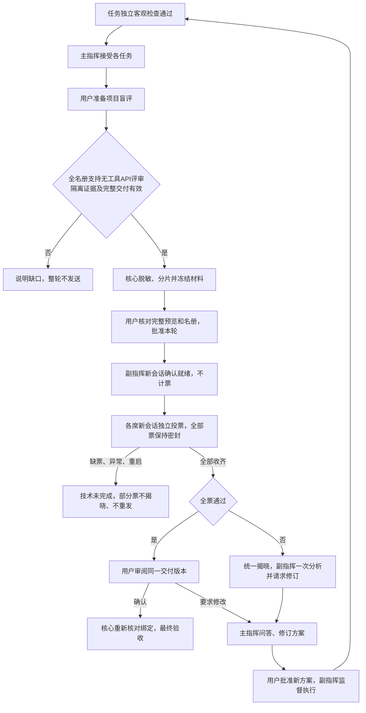

> 2026-11-04历史资料整理说明。原始本地证据已按维护者要求提炼归档，历史结论和边界保存在维护者本地的 docs/build-cache 文档目录。文中原路径用于识别历史记录。

# 项目盲评实际实施方案

2026年11月3日。依据三轮自评F01—F12实施。本文是新开发版方案，不改变已发布0.1.34或旧任务的验收事实。

## 产品流程

保持任务级独立检查与主指挥接受。所有任务接受后，由用户在“项目盲评”审阅核心生成的整体验收材料和名册，批准本轮网络调用。副指挥先通过独立无工具请求确认材料具备评审条件；该确认不算一票。随后主指挥、副指挥及批准方案中的不同执行身份逐席评审，每席一票。完整票集统一揭晓；全票通过后用户确认同一交付版本才记为最终验收。

未通过时，核心在全部票据揭晓后，向同一副指挥的新无工具会话派发一次分析，记录遗漏、验收标准疑议和主指挥修订请求。界面显示建议，用户审阅并进入既有主指挥问答与方案修订流程；用户在全票后提出修改也使用该入口。新方案仍须批准后才能执行。分析失败不改原拒绝结果，不重发。超时、缺票、协议错误或身份不符进入技术未完成，不揭晓部分选择、不缩小名册、不自动重发。

## 落地边界

- 核心新增独立领域协议、持久评审账本、材料封装、无工具供应商传输和项目界面。模型没有评审账本接口；提交入口仅存在于核心持有的请求回执处理路径，用户IPC不能伪造某席投票。
- 首版接入可证明无本地工具的API评审会话，严格继承已批准模型及端点。CLI、桌面及外部主指挥聊天未证明同等评审隔离时，整轮在发送前拒绝，不省略席位、不自动换模型。正常执行接入不受影响。
- 所有评审请求为新上下文，发送同一冻结材料视图。源码切成小片段，路径改为核心编号；原路径、原文摘要、原对话、stdout/stderr及其他票据不进入请求。
- 脱敏在核心内以非执行方式处理字节，不加载仓库插件或运行仓库钩子。用户批准明确的替换规则；变换结果和完整性一起进入批准摘要。不会用粗糙删注释破坏语义后声称审阅原程序；发现疑似秘密或无法安全表达的材料时拒绝发送。
- 检查仓库代码的程序必须使用独立Windows账户。复用执行账户的身份核验及Job生命周期管理，只开放本次检查工作副本和临时目录；核心证据、凭证和票库保持私有。新机制拒绝把旧宿主权限检查记录当成新增隔离证据。
- 材料以最终集成任务的完整封存树为准；无集成任务的单目录项目取已接受提交并核对当前完整树。多个独立交付目录必须先有明确集成产物，不任意拼接声称整库覆盖。排除项及无法审阅的二进制不能静默忽略。
- 每席预留独立固定输入/输出和期限；不暴露共享剩余额度、缓存命中或他席进度。原片段、序列化请求、累计输入、席位数和整轮都有边界。
- 所有状态改变在持有核心写入锁时比较轮次与绑定后持久记录。网络调用前持久保存派发意图；重启时未决调用终止为未完成，旧运行代次的回包不能复活轮次。
- 用户最终确认重新核对方案、配置、客观证据和交付树。旧Completed仅表示执行完成；新最终验收由核心单一判定提供。备份包含新账本，恢复后不自动联网；旧阅读器不得忽略新数据格式。

## 当前实现约束

- 新开发分支上接线，发布版本仍为原0.1.34；没有替换用户的安装程序。
- 首版采用用户显式准备和材料批准。批准后副指挥就绪、各席投票、结果揭晓及失败分析自动续接；不是任务结束后无确认联网。
- 目录隔离项目应先在项目设置中补齐Windows账户，再批准方案和开始执行；API执行模型的客观检查也需要该账户。未就绪时检查停止，不降回宿主身份。旧无隔离证明的已接受任务不能直接参加新盲评，需要按原修订/复验流程取得新证据。
- 3至7席：主副指挥各一席，批准方案中的1至5个执行身份各一席。同一执行身份去重，主副指挥即使同模型也按角色各一票。
- 源文件最多128个，单片最多2048 UTF-8字节，最终材料JSON最多96KiB，序列化请求最多192KiB。所有任务封存输入累计最多512个文件、512KiB；超限、非UTF-8或缺少集成交付时明确拒绝，不省略后声称审查完整。
- 每轮最多“席位数＋2”次网络请求，包含就绪及可选失败分析；每次输出4096 tokens、90秒，整轮15分钟。无自动重试、无金额保证。实际模型只按供应商返回名称及用户批准别名核对，不能证明供应商内部权重或记忆隔离。
- 检查器只能在与核心不同的账户下运行新目录隔离任务，复用该执行身份的Windows账户，不另外宣称有第三个账户。固定工具须预先对该账户可读。先保存临时ACL租约，检查后回收；中断遗留或回收失败阻止该账户继续派发，保留现场。771已补实际账户的票库读写拒绝、管道拒绝、子进程身份及读取拒绝、退出后工作副本读取拒绝证据；结论限于该Windows环境及所测边界。
- 检查工具以操作系统进程工作目录为准。Windows PowerShell 在无权读取祖先目录时，其文件系统提供程序的 `Get-Location` 可能退回 `C:\`，即使进程工作目录正确；PowerShell 检查脚本应使用 `[Environment]::CurrentDirectory` 与 `[IO.Path]::Combine` 读取批准副本，并以 `$ErrorActionPreference='Stop'` 处理读取异常。核心不会为了兼容提供程序而开放证据/票库目录，也不会静默改写已批准的检查命令。
- 备份和恢复在写入任何盲评数据前创建私有目录；核心重开将旧收票及未结束分析许可撤销。原票据字节和历史失败保留。
- 启用前检查同一数据目录内其他项目的执行配置、外部主指挥聊天和后台活动；存在旧宿主权限配置时整轮拒绝。reader19启用后，CLI、OMP、桌面和客观检查的旧宿主账户启动路径拒绝运行，外部主指挥聊天不能新接入。既有普通账户隔离接入仍可正常执行。建议从独立实验工作台启用，避免影响旧项目。此处不声称能限制用户另行启动的其他核心版本、同账户外部程序或管理员。
- 失败后的修订上下文使用完整副指挥摘要、原轮次和逐票摘要引用；完整原理由仍在原票据中，未覆盖或混入历史管理请求。没有新增模型可调用的文件/投票IPC。

## 对应风险与验证

| 自评项 | 实现要求 | 必要测试 |
| --- | --- | --- |
| F01—F02 | 独立检查账户；私有票库；模型无通用IPC与文件工具 | 真实权限拒绝、子进程、模型伪造票及越权字段 |
| F03—F04 | 全材料受控封装；路径编号；显式脱敏；新会话 | 路径、日志、原对话、秘密、跨片标记不从旁路进入请求 |
| F05—F06 | 最终状态独立；完整绑定；单写入者持久状态 | 缺票、反对票、旧确认、修订竞争、重复/冲突回包 |
| F07—F08 | 重启撤销在途请求；缺票终态 | 派发前后崩溃、恢复、不重发、迟到回包 |
| F09 | 完整交付清单与原检查证据绑定 | 文件增加、删除、变更、遗漏与集成来源不符 |
| F10—F11 | 独立预算、UTF-8及最终JSON字节计量 | 多字节、累计/包装超限、不跨席复用上下文 |
| F12 | 批准模型解析规则；无静默回退 | 不符模型、合法明确别名、工具请求、截断及重复JSON键拒绝 |

本轮以实际实现测试为准，不把769合成场景转写为产品通过。未知问题保留原始回执。脱敏不能证明任意代码完全没有暗号，API供应商报告的名称也不能密码学证明底层权重。

## 可核验入口

- 领域协议：`crates/domain/src/blind_review.rs`；私有账本和恢复：`crates/core/src/blind_review.rs`。
- 材料边界：`crates/core/src/blind_review/material.rs`；生产项目接线：`crates/core/src/blind_review_host.rs`。
- 无工具供应商调用及严格回包：`crates/adapters/src/blind_review.rs` 与 `blind_review/wire_json.rs`。
- 界面：`apps/desktop/src/BlindReviewPanel.tsx`；查看位置为工作台“需求与计划”。
- 验证：`crates/core/src/blind_review/tests.rs`、`crates/core/src/api_run_tests.rs` 和 `tests/blind-review-ui.mjs`。
- 完整原始日志及后续状态记录在历史证据库 `D:\test\CeruleanLonging\reports\blind-review-implementation-770`。本文件的实现描述不替代该目录中真实的通过、失败及未执行记录。

## 本轮验证状态

- 新增盲评核心17项、供应商协议5项通过；界面8个场景通过，已查看宽屏和窄屏截图。覆盖密封、全票、身份绑定、重复/迟到回包、实际进程退出、冷备份恢复、失败分析及旧宿主权限配置拒绝。
- 原检查器进程集成测试18项通过；领域协议50项通过。综合适配器156项及核心1037项通过，核心另有1项旧的无账户成功预期失败、290项显式实测未执行。旧成功路径保留为需要独立账户的实测；新增缺账户停止回归已定向通过。没有把原失败改为成功回执，也没有重跑并声称全量已经全绿。
- 前端类型检查、Vite构建和Rust严格Clippy通过。桌面静态检查临时排除了尚未准备的封包资源，生产配置未改；此结果不代表安装包验收。
- 770的UAC取消/失败记录保留。771在用户明确“重新弹一下”后成功创建普通测试账户。原生客观检查暴露了PowerShell提供程序目录误读，修正检查脚本后，又发现并修复并行调度错误引用旧方案失败的问题。新增API调度回归11项通过、10项显式测试未执行；包含八种路由、历史失败保留、当前失败停止和缺账户拒绝。
- 771的修订方案已完成两个真实跨账户客观检查、主指挥接受、合成API盲评、用户最终确认及重开。整链测试随后因边界脚本未可靠等待子进程而退出失败，原回执保留；仅补测修正后的边界脚本通过，并再次只读核对 `finalAccepted=true`、`isCurrent=true`。没有重跑已完成整链，也没有将失败回执改成成功。证据位于 `D:\test\CeruleanLonging\reports\blind-review-native-771`。
- 没有真实供应商请求；没有替换日常安装、推送GitHub或发布新版本。完整源码基线与最终字节由770证据目录单独冻结，769自评证据保持原样。

## 771并行调度修复

并行分支曾按项目筛选所有失败检查；即使旧任务已结束、用户批准了新方案，历史失败仍会拦截新任务的启动提交。现在将检查关联到当前任务的实际尝试；仍未通过的当前尝试继续停止，已通过批准复验的当前任务和旧版本失败不会相互混淆。未知检查仍在上层整体阻断，原失败账本与检查文件保留。改动位于 `crates/core/src/project_runner_parallel.rs`。
