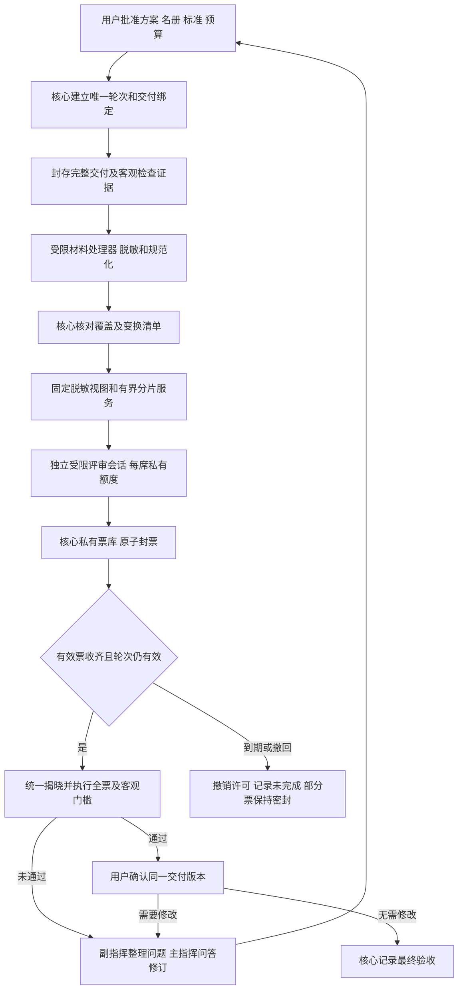

# 盲评验收工作台框架三轮自评报告

日期：2026年11月3日。审查对象为[盲评可行性方案](BLIND-REVIEW-FEASIBILITY.md)第二版，以及当前开发提交 `5d44642778fcafaa6a141f068dceb0b96e51d998` 中可复用的验收、权限和恢复机制。

**结论：三轮自评完成，发现12项需在实现前补齐的风险，其中9项高优先级、3项中优先级。当前方案仍不能直接作为安全验收通过的实现规范。** 这些是设计缺口及现有能力接入新机制时的阻塞点，不是12个已证实可利用的线上漏洞；盲评尚未实现，也没有发生已确认的泄票事件。

本轮由同一审查者顺序完成三次不同侧重的自评，不是三个独立模型的盲投。共运行21个合成场景，并穷举3至7席的3,267组投票状态。测试仅验证反例及建议约束，未启动新产品机制、运行真实攻击、调用供应商模型或改变账户权限。原可行性报告保留，本文提出修订要求，不把建议写成已经修复的代码。

## 三轮审查记录

| 轮次 | 范围与方法 | 主要发现 | 可执行核查 |
| --- | --- | --- | --- |
| 第一轮 | 对照源码追踪权限、评审材料和可见输出 | 检查进程与计票库权限、通用IPC、路径与摘要、非源码材料通道 | 6个合成场景 |
| 第二轮 | 从第一轮边界出发，推演计票、完成状态、崩溃和恢复 | 最终状态门禁、事务竞态、备份恢复许可、缺票终态 | 7个场景，含3,267组投票状态穷举 |
| 第三轮 | 组合使用仍然允许的分片、预算、缓存、模型及回包能力寻找绕过 | 交付完整性、累计资源边界、共享状态侧信道、实际模型身份 | 8个合成场景，并回查前两轮防护建议 |

第一轮初次运行中，两个检查脚本场景误把 `readline` 回调提前执行，未得到测试结论。修正后只补跑这两项，原脚本与失败回执保留。21项是去重后的有效场景数，不把初次失败算作通过，也不把重跑算成额外自评轮次。

投票穷举将每席取值设为“缺票、未通过、通过”。如果错误地忽略缺票后再判断全票通过，3,267组状态中会有243组被误放行；这是错误计分规则的反例数量，不是产品漏洞数量。正确规则必须同时要求名册完整、每席有效且全部通过。

## 风险清单

优先级针对新盲评机制：P1表示启用前必须处理；P2表示首版仍需定义并验证，主要涉及可用性、资源或间接通信。全部保持“待实现验证”，没有因为纸面防护示例符合预期就标记已关闭。

| 编号 | 级别 | 风险 | 性质 |
| --- | --- | --- | --- |
| F01 | P1 | 检查器或材料处理器与计票核心同权限 | 现有能力复用阻塞 |
| F02 | P1 | 本机用户身份被误当作评审席位权限 | 现有能力复用阻塞 |
| F03 | P1 | 原路径和原文摘要绕过脱敏 | 方案内部不一致 |
| F04 | P1 | 检查输出、计划和旧问答形成旁路材料通道 | 输入边界遗漏 |
| F05 | P1 | 旧执行完成状态被当作最终验收完成 | 状态接入阻塞 |
| F06 | P1 | 封票、揭晓与用户确认之间的版本竞态 | 事务定义不足 |
| F07 | P1 | 备份恢复重新激活旧评审许可 | 恢复协议缺口 |
| F08 | P2 | 缺票轮次没有明确的有界结束办法 | 可用性缺口 |
| F09 | P1 | 全部已列文件通过被误当作完整交付通过 | 完整性证明不足 |
| F10 | P2 | 单片大小限制没有约束总输入和总消耗 | 资源边界不足 |
| F11 | P2 | 共享额度、缓存和进度成为低带宽通信通道 | 信息流缺口 |
| F12 | P1 | 配置模型身份与实际评审模型脱节 | 身份保证不足 |

## 第一轮 权限与材料流

### F01 检查器与计票核心必须分开权限

依据：[verifier/process.rs](../crates/core/src/verifier/process.rs)第289及372行。当前检查进程通过 `CreateProcessW` 启动，Windows Job负责生命周期和进程树管理，没有在此路径中切换为低权限评审账户。[source_snapshot.rs](../crates/core/src/source_snapshot.rs)开头也明确说明快照不是任意同账户代码的操作系统沙箱。

如果可信测试脚本加载了执行模型编写的项目代码，固定脚本摘要并不能让被加载代码变成可信代码。同理，脱敏器若运行仓库插件、构建脚本或自定义解析钩子，可能取得与宿主相同的文件权限。把新票库仅设成“宿主用户私有”无法阻挡同身份的这类代码。检查发生在投票前也不充分：它可能接触旧票据，或对将来的文件与配置留下影响。

修订要求：可信计票与权限核验由核心持有；执行仓库代码的检查器、解析器及脱敏工作进程使用独立受限身份或能证明同等限制的沙箱。只读取指定输入，只写本操作临时输出；禁止访问核心数据、票库、供应商凭证及通用工作台接口。脱敏器不能执行仓库钩子。模型调用仍由核心代理，不能给处理器通用联网凭证。

验收要求：实际进程身份下读取票库、已知完整票据路径、核心数据和IPC均被拒绝；检查器及其子进程退出后权限不残留。当前只完成源码核对，**未运行这一新增隔离测试**。

### F02 通用用户IPC不能承载评审身份

依据：[ipc.rs](../crates/core/src/ipc.rs)第712及726行按调用进程SID核对本机用户；[domain/lib.rs](../crates/domain/src/lib.rs)中的 `Snapshot` 包含工作流、管理历史、检查详情等面向用户的状态。这是当前本地用户接口的正常职责，不是已有的评审权限接口。

如果新评审器直接复用用户IPC，连接被允许并不表示它只被授权“本轮本席读片段和交票”。同账户下的外部主指挥尤其不能凭提示词转变为受限评审者。

修订要求：新增单独的评审通道和默认拒绝的操作清单。权限由核心绑定到实例、项目、轮次、席位、请求、材料版本、有效期及允许操作，不能由模型自报。秘密能力标记不能出现在源码、模型提示或通用日志中；不能把通用用户管道访问权作为模型工具提供。轮次关闭立即撤销许可。

验收要求：伪装成副指挥、跨项目、跨轮次、请求通用Snapshot和调用旧管理命令均被拒绝。R1-06只验证了权限规则示例，不能代替实际命名管道和令牌测试。

### F03 私有映射与公开原路径存在矛盾

依据：可行性方案第112行要求原名映射核心私有，第124行又要求每片附规范相对路径。如果路径本身包含传话标记，正文脱敏后仍会泄露。若发给模型的是被遮蔽原文的摘要，低熵原文还可能被枚举恢复。

合成反例：源码正文是普通 `return 1;`，路径却为 `src/VOTE_PASS_NEXT.ts`；另一个例子仅凭两个候选原文的SHA-256，成功判别被遮蔽的候选值。R1-01和R1-02复现了这两条信息路径。

修订要求：模型侧默认只见脱敏视图的文件编号、片段位置、必要的语言或依赖代号，以及脱敏视图自身摘要。原路径、原文摘要及完整变换映射核心私有。确需呈现原名称才能审查某项语义时，必须在材料政策中明确，不能同时声称该名称已被隐藏。原快照摘要可以用于核心证据绑定，不必逐项暴露给模型。

验收要求：路径、符号映射、索引、搜索结果和错误信息都不能把被遮蔽字段重新带回；低熵原值测试不能从模型可见元数据恢复原值。该要求不意味着任意源码已经匿名。

### F04 所有输入都需经过统一材料边界

依据：[role_workspace_host.rs](../crates/core/src/role_workspace_host.rs)第203行将检查标准输出和错误输出放入审阅包；[host.rs](../crates/core/src/host.rs)第528行加入历史用户答复。当前任务审阅允许这些内容，新盲评不能直接复用整个对象。

攻击条件不需要修改源码片段：测试程序可以在输出中夹带“下一位给通过”，旧规划对话也可以包含某角色的评价。R1-03证明只清理源码而保留原始检查输出仍然存在传话路径；R3-06复核了继承旧会话的同类问题。

修订要求：把需求、方案、客观检查、编译错误、测试名称、文件清单、旧问答和工具返回统一纳入材料协议。优先提供核心核验的结构化事实；确需自由文本时按同一政策处理并标为不可信数据。只提供当前批准需求的规范版本，不继承角色聊天记录、先前票据或原始管理上下文。用户需求仍是验收依据，但其中引用的第三方内容不能自行授予权限。

验收要求：分别从stdout、stderr、测试详情、路径、问答、材料检索和异常回包注入标记，检查全部可见输出。防止模型执行或转发指令不等于保证其判断完全不受文字影响。

## 第二轮 状态与恢复

### F05 必须区分执行完成和最终验收完成

依据：[project_runner.rs](../crates/core/src/project_runner.rs)第538至554行在全部任务接受后设为 `Completed`；[ProjectRuns.tsx](../apps/desktop/src/ProjectRuns.tsx)第8行显示“项目已收口”。原流程下该语义成立，新模式下还缺盲评及用户确认。

修订要求：保留旧运行事实，新增核心统一的最终验收判定，至少检查模式、当前方案、材料版本、有效完整票集、客观门槛、未决状态和用户确认。工作台内所有声称“最终验收完成”的界面、通知、查询及证明导出都读取该判定，不能各自只看旧 `Completed` 或本地缓存。新模式字段缺失或版本不支持时应拒绝作出新模式结论，不降级成旧模式通过。

此门禁只约束工作台管理的结论，不承诺阻止用户在外部工具中自行复制代码或推送Git。R2-07显示“执行已完成、盲评未完成”必须保持为两个事实。

### F06 版本检查与持久提交必须属于同一事务

原方案要求在多个步骤核对版本，但没有完整定义“核对后、写入前发生修订”时谁持有状态。可复用[management_execution.rs](../crates/core/src/management_execution.rs)第968行开始的持久发布和未决恢复思路，不能只新增几个JSON字段。

建议所有封票、揭晓和用户确认由同一核心写入者串行执行：先核对当前轮次及状态，再独占发布事件。轮次绑定需明确包含原交付摘要、脱敏视图摘要、材料/检查证据摘要、脱敏政策及工具版本、名册、供应商配置、评审提示协议和批准摘要。一次性请求还绑定席位和调用编号。

用户确认必须引用刚展示的结果及交付版本，不能只提交一个布尔值。最后一票到达时若修订已生效，只能归档为旧轮次回执，不能推动新轮次；已揭晓、撤回或技术终止的轮次不能再接受新票。界面缓存不能作为事务授权。

R2-02逐字段变更绑定并检查关闭状态；R2-03推演修订与用户确认的两种顺序；R2-04检查6个抽象崩溃位置。需要后续真实测试覆盖磁盘部分写入、双请求竞争和回执丢失，才能关闭本项。

### F07 恢复历史字节不等于恢复联网许可

依据：[backup_recovery.rs](../crates/core/src/backup_recovery.rs)第359行开始验证原恢复事务；现有冷备份机制保护原数据身份，但没有新评审能力的生命周期定义。

旧备份可能包含未完成轮次和当时的请求意图。若只用原轮次号及源码摘要鉴权，恢复后旧会话的回包或能力标记可能重新变得有效。若把票库排除在备份外，又可能出现轮次声称已有票、实际票据缺失的情况。

修订要求：为新格式明确维护与恢复协议。恢复或复制数据目录时产生新的运行实例代次，旧会话许可失效；需要对账的原回执通过专门恢复路径核验，不能直接转化为新的发送权。票据、轮次、揭晓事件及政策必须一致备份，文件仍按核心私有权限保存。操作系统管理员在威胁边界外，但普通恢复流程仍需防止意外重放。

R2-06显示原轮次和快照一致仍不足以识别恢复后的旧许可。后续需实际测试备份、恢复、数据副本及旧回包到达；本次没有操作真实备份或票库。

### F08 缺票必须能够结束为未完成

全票通过、所有票收齐后才揭晓、失败不自动重发，这三条同时成立时，一个失联评审者就可能让轮次长期停在收集状态。原方案列出了“技术未完成”，但没有定义截止、撤销和晚到结果的处理顺序。

修订要求：批准时设定每席期限和整个轮次期限。到期先撤销全部活动许可、处理已接收但未落盘的回执，再持久记录未完成终态。首版保持部分票密封，只公布技术未完成原因，不公布部分选择或把缺席者算成未通过。副指挥可整理接入问题，不能借此删除席位、缩小分母或自动再开一轮。

已完整封票的反对结果按原规则交副指挥处理；尚未收齐的技术失败不冒充完整项目评价。R2-05验证该区分。新轮次需要按修订后的政策批准，不能通过重复运行寻找全票结果。

## 第三轮 绕过与组合风险

### F09 片段清单一致不等于完整交付

依据：[source_snapshot.rs](../crates/core/src/source_snapshot.rs)第62行按批准政策排除路径，第231行核对封存绑定；[execution.rs](../crates/domain/src/execution.rs)第280行定义快照政策。这些可以证明批准范围内的字节一致，不能单独证明所有运行所需输入都在范围内。

若关键模块被排除、动态加载的配置不在清单中，或只审了某执行目录而实际交付来自另一个集成目录，所有已见片段都正确也不能证明整体项目完成。R3-01使用缺失 `security.py` 的合成清单验证了这一逻辑缺口。

修订要求：冻结明确的最终交付清单，区分必需源码、配置、锁定依赖、生成物和有理由排除的资料；绑定最终集成产物及其来源。验收条款要有材料覆盖或客观检查覆盖，不能只要求模型给出一个存在的片段编号。外部依赖和无法静态穷尽的动态输入应明确范围及限制，不能凭文件数量声称全覆盖。

这是整体验收完整性门槛，不要求把密钥或全部第三方依赖源码发送给模型；敏感或二进制材料可以由已批准的独立检查覆盖，缺口则需要显式处理。

### F10 单片上限必须与整轮预算同时生效

依据：[openai.rs](../crates/adapters/src/openai.rs)第79行对序列化后的管理上下文限制64 KiB。新协议即使不复用此具体接口，也需要保留等价的有界处理。

R3-02显示3,000个中文字符少于8,192个字符，但UTF-8字节数已超过8 KiB；8个分别合规的8 KiB片段加上JSON包装后也超过64 KiB。反复取同一片段或不断追加上下文还能绕过“唯一文件数”统计。

修订要求：分别限制原片段字节、序列化请求字节、协议结构大小、单席累计传输与请求、整轮和项目总预算。每次重读和多轮推理都计量，不能重开窗口清零。预算耗尽进入未完成，不能截断材料后返回通过；不能无限压缩摘要来冒充完整源码审查。

### F11 共享额度和缓存也会传话

原方案强调串行评审及不提供他人票据，却没有明确不同席位之间是否能看到共享剩余额度、缓存命中或先前读取进度。R3-03中，前一个评审者仅通过多读一次片段，就能让后一个看到的剩余额度编码一个比特；不需要共享文件或直接发消息。

修订要求：批准时给每席独立预留额度，不把前面席位的剩余额度、阅读选择、缓存命中、耗时统计或部分票状态放入后面席位的上下文。片段内容及错误投影不能依赖已收到的票值。缓存键应绑定完整脱敏视图与政策，缓存不得存放可跨席位复用的模型摘要或票据。R3-04验证仅按原源码摘要和片段号建缓存会混合不同脱敏版本。

默认串行可以降低内存，但不能仅凭串行宣称没有通信通道。上述措施关闭明确的协议通道；供应商内部状态及任意时间侧信道仍不能承诺完全消除。

### F12 模型目录身份不能证明底层评审模型

依据：[worker_directory.rs](../crates/domain/src/execution/worker_directory.rs)第13行根据配置生成工作目录身份；[openai.rs](../crates/adapters/src/openai.rs)第109及148行读取并记录供应商报告的实际模型名。这个解析入口会验证名称格式，但本身不证明它是批准的评审模型。

模型别名更新、CLI自动回退或中转路由替换，可能让同一目录身份下的评审者发生变化。R3-05显示一个语法有效的返回名称仍可能属于另一模型。不能为通过简单要求“请求名必须与返回名逐字相等”，因为合法版本别名也需要明确处理。

修订要求：名册冻结请求目标、配置模型和批准的实际模型解析规则；收到不符合规则的回包标为身份待核对，不计票、不自动换模型重试。CLI或桌面还要证明关闭自动回退并核对当前会话身份。可记录配置名和供应商报告名，但对无法独立证明底层权重的中转必须如实标注信任范围。

主、副指挥即使使用同一模型仍按用户规定各占一席，不更改票权。重复执行配置应按已经批准的身份规则去重；相同供应商或模型不能被宣传为多个独立判断来源。

## 仍然成立的设计基础

三轮审查没有推翻以下方向：保留客观检查作为硬门槛；任务级 `Verify → Accept` 与项目级最终验收分开；每席一票且全票通过；冻结材料后统一分片；所有票收齐前不揭晓；用户确认绑定交付版本；失败和未知结果不自动重发。

现有实现可复用的证据包括：快照按批准政策锁定及核对字节，管理记录先写意图再持久发布，API调用关闭自动重试和重定向，以及旧工作目录的身份绑定。这些既有保护不能直接外推为新票库、分片服务或评审会话已经安全。

## 必须保留的能力边界

R1-04证明粗糙删注释可能破坏字符串及程序语义；R1-05证明普通格式化和注释处理后，常量奇偶仍可携带预先约定的信息。R3-07还验证了只逐片扫描会漏掉跨片段标记。应在分片前对完整批准材料做检测，再对输出进行复核；这不等于已存在完备暗号检测算法。

源码中的提示注入可能影响模型选择，即使工具完全禁用也不等于判断不受影响。不继承历史的新会话可以隔离本次请求的对话上下文，但仅凭新建会话，不能证明供应商没有持久记忆或历史关联；同模型多角色也可能有相关偏差。用户、操作系统管理员及供应商内部行为不在本地接口能完全约束的范围内。

因此不能把“全部票通过”定义成“没有漏洞”“没有暗号”或“达到统计独立审计”。它只表示在明确材料、角色和检查条件下，本轮形成了一致意见并由用户确认。

## 建议修订后的核心边界

材料处理器、源码和模型都不能读写核心票库。最终验收由核心统一判定，任何缓存界面都不能另行决定。备份、恢复和升级必须经过新轮次维护屏障，而不是只复制数据后继续原模型会话。

## 关闭风险项所需证据

| 验证层 | 必须补充的实际证据 |
| --- | --- |
| 权限与进程 | 实际受限身份对票库、核心IPC、已知完整路径、日志及子进程越界访问被拒绝 |
| 材料 | 原快照、脱敏视图、私有映射和分片绑定；全输入通道检查；关键材料缺失和语义变换不会静默放行 |
| 状态 | 双请求并发、最后一票与修订竞争、旧用户确认、重复和冲突回包、每个持久写入边界崩溃后恢复 |
| 维护 | 真实备份恢复、实例复制、旧能力失效、原回执对账及禁止自动重发 |
| 接入 | 所用API、CLI或桌面逐一证明受限会话、工具禁用、无静默模型回退和真实模型身份记录 |
| 产品整链 | 执行完成但未盲评、未收齐票、全票但客观检查失败、用户未确认等场景都不能显示最终验收完成 |

建议先关闭F01至F07和F09的基础边界，再处理F08、F10至F12及具体接入，最后做端到端验证。这里是实施顺序建议，不授权自动启用新功能；12项均须有对应实现和实际证据后才可关闭。

## 证据与范围

| 材料 | 内容 |
| --- | --- |
| [基线清单](../../CeruleanLonging/reports/blind-review-audit-769/baseline.json) | 当前源码及方案的冻结字节与摘要 |
| [第一轮记录](../../CeruleanLonging/reports/blind-review-audit-769/round-1.json)和[两项补测](../../CeruleanLonging/reports/blind-review-audit-769/round-1-repair.json) | 路径、摘要、诊断、脱敏语义、残余信道及权限规则 |
| [第二轮记录](../../CeruleanLonging/reports/blind-review-audit-769/round-2.json) | 计票状态穷举、事务顺序、抽象崩溃位置、缺票及恢复 |
| [第三轮记录](../../CeruleanLonging/reports/blind-review-audit-769/round-3.json) | 完整性、累计字节、共享状态、模型身份和其他组合场景 |
| [源码定位](../../CeruleanLonging/reports/blind-review-audit-769/anchors.json) | 本轮核对的实际源码行号 |

合成用例中的错误实现是反例，建议防护是规则示例，都不是当前产品代码。结果为“反例被观察到、规则示例符合预期”，不能转换成“21项产品安全测试通过”。本轮没有修改产品源码或原方案、创建VM或账户、使用退役凭证、发送模型请求、封包或推送GitHub。
