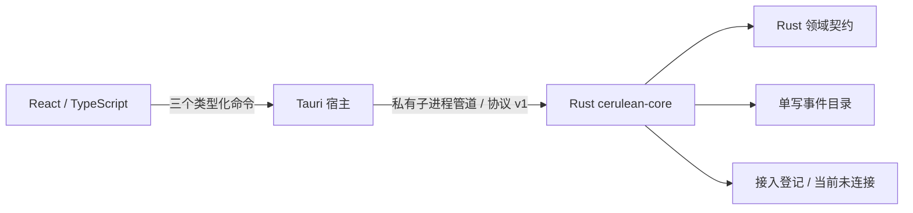

# CeruleanLonging 基础架构与迁移边界

2026-10-07 基础搭建历史记录。**后续传输层已迁移至常驻命名管道服务，见 [最新服务说明](RESIDENT-SERVICE-V1.md)。下方私有管道与随窗口退出的描述只对应基础搭建时点。**旧实验报告按原时间保留。

## 已落地边界

当前命令是 snapshot、createPlan、approvePlan。没有执行命令、任意 shell、任意路径写入的前端接口。批准摘要由 Rust 生成并验证；当前计划由用户手工录入，不能把它称为 AI 主指挥计划。

核心通过操作系统私有 stdin/stdout 管道与宿主通信。每请求包含版本与 ID，响应必须匹配；请求上限 64 KiB、响应 4 MiB、宿主等待 15 秒。通信失败或超时不自动重发；重开由账本恢复。模型凭证尚未进入工程。

正式方案的“常驻核心 + 当前用户命名管道 + CLI 共用核心”仍作为 P1 的交付目标。基础搭建先用独立子进程完成可测边界，不能将当前随桌面退出的核心标为常驻服务。后续沿用相同 DTO 与领域层，更换传输层及生命周期。

## 数据

每事件独立 JSON，序列文件名、前序哈希、正文哈希、接收时间与类型。写入独占临时文件、sync 后同目录 rename。打开时全量扫描、重放、检查内容摘要与序列；临时文件不当作已提交事件。不以文件年龄回收写锁；使用进程持有的系统文件锁。

基础版只含计划建立与用户批准事件，尚无派发副作用，因此不能宣称已迁移完整 unknown/取消/租约状态机。P1 必须复用原型的输入事件和故障场景逐项对照。此机进程恢复不等于物理断电保证；同用户恶意代码也不在当前文件约定能隔离的范围。

完整每日分卷、SQLite 派生索引、任务依赖和资源租约尚待迁移。界面“交接记录”当前显示已提交事件，不以普通 Markdown 修改来批准任务。

## 接入与支持矩阵

所有首批对象仍保留。主副指挥限定 OpenAI；xAI 按 API；Qoder 与 WorkBuddy 保留现有桌面聊天路线。当前产品登记状态统一 planned，没有假连接、假执行或把供应商余额与费用填为零。

原型 Qoder GLM 配置 20/20 和 WorkBuddy 20/20 作为迁移证据，不免除产品版本、模型、会话绑定与故障复测；旧 Qwen 配置两次错误继续保留。

## 基础交付门槛

1. 产品名、窗口名、工程与入口统一 CeruleanLonging。
2. Rust 与 TS 可构建；生成类型可复现。
3. 真实核心进程能保存、拒绝错误批准并跨重启恢复。
4. 真实桌面能完成计划创建、明确人工确认与记录读取。
5. 依赖锁文件、检查脚本、后续缺口和运行方法可审阅。

依据：[Tauri Windows 前置要求](https://v2.tauri.app/start/prerequisites/)、[Tauri 外部二进制](https://v2.tauri.app/develop/sidecar/)。本项目只调用固定核心二进制，不向界面开放通用 shell 插件。
