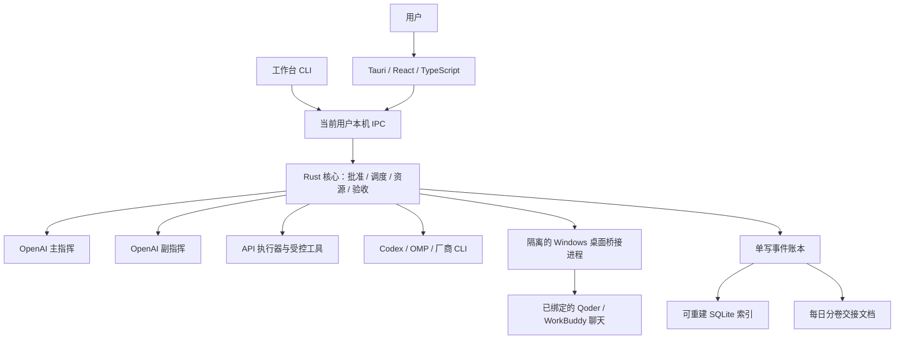

# CeruleanLonging 具体实施方案

日期：2026-10-07。用户已授权以 CeruleanLonging 正式开工，当前进行基础搭建。工程位于 D:\test\CeruleanLonging，原型仍位于相邻 workbench-probes。实际完成情况以 FOUNDATION-STATUS.md 为准；下列 P0–P6 为完整路线，不能将基础骨架视为全阶段完成。

本方案继承用户已确定的 Tauri + TypeScript + Rust、三级团队、编程优先、文件交接和首批接入范围。依据为 `workbench-probes` 的真实实验和本次验收报告；v1 保留为历史。本文提出的阶段、默认值和工作量属于工程建议，不是已经实施或用户已经批准的事项。

## 1. 产品决策

建议做单用户、Windows x64、本机执行优先的桌面工作台。主线是独立 Rust 核心管理任务，Tauri 承载界面，TypeScript/React 呈现计划、批准、执行和验收。API、原生 Agent/CLI、已打开的桌面聊天通过不同适配器进入同一调度系统。

先完成可验收的编程闭环，再扩齐首批供应商和桌面兼容范围。Qoder、WorkBuddy 仍是完整首批版的必需项，不能用新 CLI 会话代替，不能因主干先交付就将完整范围标为完成。用户已授权基础搭建，开始安装工具链、建立 Tauri 工程和 Rust 核心边界；后续按下列阶段推进。

实测支持架构可行，但不支持“所有接入已经稳定”“多模型必然提效”的承诺。一次真实主管闭环的三次管理调用合计约 49.5 秒；微型串行模拟任务的双执行者流程约为单执行者耗时的 4.9 倍。这两个结果的范围不同，均不能外推真实大型编程项目。小任务应保持一名执行者，副指挥由异常事件唤醒。

最新连续验收：WorkBuddy 5.7.6 在既有聊天连续 20/20、零重发。Qoder 0.4.3 经用户再次确认原会话后，兼容空编辑框换行并用指纹保留、核对业务历史。两批发送 12 次，10 次正确、2 次新回复复用旧标记；均正确关联，错误结果未被验收，0 重发。一轮读取失败通过只读对账恢复。上述 Qwen 配置仍判未通过。第 28 步只读发现模型已切至 GLM-5.3-Flash 最大设置，随后同会话、相同简化提示结构完成新一批 20/20、零重发，逐轮独立复核和账本重放通过。由此补齐本次原型重复基本流程门槛，不能抹去旧失败，也不能锁定旧失败的根因。P0 冻结应用版本、模型配置及提示契约；P4 按支持配置逐组验收，失败配置不自动列为通过，换模型或升级需重新验证。完整桌面可靠性仍须通过下列产品门槛。

## 2. 从两个开源工作台采用的机制

| 参考机制 | 本项目的具体落点 | 不直接照搬的部分 |
| --- | --- | --- |
| Cherry 的 Host/Driver 分离、会话投递由应用持有 | `SessionHost` 负责队列、状态、恢复；适配器只转换协议与证据 | 不让每个适配器自带权威任务账本 |
| Cherry 的统一输出事件 | Rust 统一序号、任务/尝试/轮次关联，界面按游标订阅 | 不把收到任何文本等同于完成 |
| AionCore 的独立 Rust 后端 | 单一 `workbench-core` 与 Tauri 窗口分离 | 本机首版采用命名管道，不照搬公网 HTTP 服务 |
| Aion 的团队任务板和依赖 | 核心持久化 DAG、负责人和资源租约；副指挥只提出分配/纠偏建议 | 主、副指挥权限按本项目重新实现 |

2026-10-07 重新查阅官方材料：[Cherry Host/Driver 文档](https://github.com/CherryHQ/cherry-studio/blob/main/docs/references/ai/agent-session-runtime.md)、[AionCore 架构](https://github.com/iOfficeAI/AionCore/blob/main/ARCHITECTURE.md)、[Aion 任务板](https://github.com/iOfficeAI/AionCore/blob/main/crates/aionui-team/src/task_board.rs)。这些是机制参考，不是同负载性能对比。正式复用源代码之前须固定 commit、核查具体文件的许可及分发义务；首版优先自行实现契约和流程。

## 3. 进程、语言与维护边界



| 部件 | 首版选择 | 交付边界 |
| --- | --- | --- |
| 桌面 | Tauri 2 + React + TypeScript | 视图、确认、通知、差异阅读；不拥有调度真相 |
| 执行核心 | Rust；Tokio、serde，HTTP/SQLite 各统一选一种库 | 单实例、状态机、批准、调度、工具、资源、事件与恢复 |
| 桌面桥接 | 初期保留经验证的 C# 子进程，Rust 通过窄 JSON 协议调用 | Windows UIA 调用有超时，子进程故障不阻塞核心；桥接源码和构建产物独立版本化 |
| 用户 CLI | Rust 小客户端 | 连接相同核心；批准规则与 UI 相同 |
| 原型 | 当前 TypeScript + Node 验证程序 | 留作对照和故障夹具，不嵌入产品形成第二套调度器 |

保留 C# 桥接是本次相对 v1 的具体修订：已经验证的桌面接口值得先复用。现有实现仍包含固定测试聊天和布局，必须改造成经用户绑定的会话契约才能产品化。仅为了统一语言重写 UIA 并不能解决控件虚拟化。如果用户要求产品必须完全不含 C#，在桌面阶段单列 Rust 桥接迁移与同样的真实验收，不能把它算作已经实现。

Tauri 可以打包外部二进制，但不会自动提供本项目的单实例、重连和任务恢复；这些由核心实现。[Tauri 外部二进制文档](https://v2.tauri.app/develop/sidecar/)

Windows 首版使用当前用户 ACL 的命名管道、长度受限帧、协议版本握手、请求 ID 和事件游标。界面使用少量 Tauri 命令代理，不暴露任意 shell。核心由显式的单实例机制启动；关闭窗口保持核心及托盘运行，完整退出须先停止派发并登记未决任务。不承诺进程全部退出后仍继续执行，不关闭用户原先打开的第三方桌面应用。

建议初始模块合并为 `domain`、`core`、`adapters`、`desktop` 四个 Rust crate，加 `apps/desktop` 前端与 `native/windows-bridge`。接口稳定后再拆分，避免一开始创建大量空模块。Rust DTO 生成 TS 类型，CI 检查协议契约；当前原型的 Node 类型剥离执行不能替代产品的静态类型检查。

## 4. 角色与用户流程

用户提出需求 → 主指挥给结构化计划 → 用户确认具体版本 → 副指挥分派 → 程序推进依赖 → 执行者提交产物 → 独立验证 → 主指挥收口。

| 身份 | 能做什么 | 核心必须拒绝什么 |
| --- | --- | --- |
| 用户 | 批准计划、变更范围、授权副作用、选择目标会话 | Agent 文本不能冒充该身份 |
| 主指挥 | 制定/修订计划，读取验证报告，接受或退回交付 | 未通过验证就接受；直接写业务交付物 |
| 副指挥 | 分配、读取进度、暂停、建议、请求重规划 | shell、改业务代码、代替执行者提交成果 |
| 执行者 | 在自己的尝试和权限范围内执行、提交证据 | 批准计划、接受成果、替其他成员提交 |
| 核心/验收器 | 校验转换、持久化、验证受测产物和权限 | 将模型自报成功直接作为验收结果 |

主副指挥的 OpenAI 限制核验提供方、端点、凭证模式及运行时配置，不能只看模型名字。无法证明上游的代理不能默认算严格 OpenAI 接入。优先采用工具注册可控的 API 指挥角色；Codex 指挥路线只有通过工具权限测试后才开放。当前真实实验“未观察到工具调用”不能替代完整权限认证。

计划批准绑定 `planId/version/contentHash/policyVersion`。用户看到目标、任务依赖、项目目录、执行者、预估费用、预算上限、工具权限和验收标准。批准后既定范围内的普通调度和可靠重试无需反复打断；新增外部副作用、扩大目录或预算、关键目标变化时生成新版本。

最小产品界面为五个入口：项目与接入、需求与计划确认、任务进度、交付与差异验收、交接与故障。状态未知时展示“正在核对，未重发”，同时保留目录/桌面资源占用；取消只有明确终态后显示完成。界面不要求普通用户阅读 JSON、PID 或控件 ID。

## 5. 任务契约与状态

`Project`、`PlanRevision`、`Task`、`Attempt`、`SessionBinding`、`DispatchIntent`、`Event`、`Artifact`、`Approval`、`ResourceLease` 分开建模。换模型、换无法续接的会话或重新执行都创建新 attempt，不能改写失败历史。

适配器能力独立声明并记录实测版本：`discover / bind / send / observe / reconcile / cancel / resume / usage / approval / tools`。返回支持、不支持、未验证三种状态。发现程序或握手成功只能证明可连接，不自动开放工具、自动恢复或精确费用。

适配器返回四类信息：消息流、运行状态、执行回执、错误。统一回执至少携带 task/attempt、适配器及版本、会话/轮次、观测时间、终态、证据路径/哈希；供应商没有 ID 时显式为空，并声明 UI 观察身份。错误区分：已明确拒绝且没有动作、可能已执行但结果未知、执行失败、需要用户、环境不兼容。

正常路径：`planned → assigned → dispatching → running → submitted → verified → accepted`。产品是否把 verified 做独立状态在契约阶段固定；原型是字段，迁移须有明确映射。辅助路径包含 `awaiting_user / blocked / cancelling / cancelled / unknown / failed`。

不可破坏的规则：

1. 已批准且依赖通过、资源可用时，先持久化派发意图，再产生外部动作。
2. 本地发送调用返回不等于提供商已经完成。超时、回执丢失或崩溃进入 unknown，禁止自动重发。
3. unknown 的可靠对账可证明未开始、运行中、已完成、已取消；证据不足就保留未知，资源不得分给新写入者。
4. 取消意图先写账本，明确拒绝前置检查可重新观察；取消动作结果未知不可重复 Invoke。任务自然完成与取消竞态分别记录。
5. 验证报告绑定实际产物哈希/受测提交及尝试。受测内容变化会使验证失效。模型答错应记录完成但验证失败，不能当作传输失败重发同一尝试。
6. 不承诺外部动作“恰好执行一次”；提供方无幂等键时依靠意图、关联证据、对账和人工处理缩小不确定性。

## 6. 文件交接与存储

用户选择项目交接目录，建议使用本机普通目录。事件账本为唯一权威，Markdown 是给人阅读、可重建的视图，SQLite 是查询缓存。不能让所有 Agent 并发编辑一份 Markdown 后直接作为任务状态。

```text
<交接目录>/.workbench/
  project.json
  plans/<plan-id>/<version>.json
  events/<sequence>-<event-id>.json
  inbox/<attempt-id>/<message-id>.json
  artifacts/<task-id>/<attempt-id>/
  daily/2026-10-07/handoff_2026-10-07_001_140000+0800.md
  index.sqlite
  snapshots/
```

首版默认 Asia/Shanghai，每卷 30 个新任务或 256 KiB，超阈值新开卷并加时间戳。更新同一任务不增加新任务计数；跨日未完成任务进入索引；迟到结果按接收日归档，另记发生时间。原型已覆盖这些规则，产品需增加可配置时区和迁移测试。

核心单写：可信通道绑定身份 → 校验提案、版本、尝试和租约 → 同目录临时文件写入并同步 → 发布事件 → 异步更新 SQLite/每日文档。相同 messageId/相同内容去重，不同内容报冲突。监听目录仅用于唤醒，恢复必须扫描并核对序号与哈希链。

日报修改不自动批准或执行任务。用户补充说明应通过界面/CLI 进入新的授权事件。报告保存行动摘要、证据、错误、下一步，不保存模型私有推理或凭证。大日志和图片作为单独产物，摘要保存路径和哈希。

现有进程退出实验不等于物理断电保证。产品阶段补足磁盘满、文件占用、索引损坏、备份恢复、写锁回收失败及大账本检查点。首版不支持多个主机或网盘同步目录共同写权威账本。

## 7. 编程执行与监督

默认模型任务并发 2、桌面动作并发 1。Git 项目每个可并行改代码的任务使用独立 worktree；无 Git 项目先采用独占目录或显式隔离副本。worktree 不能隔离端口、数据库或用户凭证，因此核心还维护这些资源租约。

执行者提交 diff、产物清单、测试命令、退出码和日志；集成任务应用变更到独立集成快照，再跑最终测试。权限范围由受控工具和运行时落实，提示词、路径字符串检查和进程拆分本身不等于 OS 沙箱。外部桌面应用使用自己原有工具权限，工作台不能声称拦住其全部工具调用。

副指挥由事件唤醒：同类错误连续出现、没有新产物的重复操作、超时、资源冲突、预算异常或执行者主动求助。建议包含证据、当前状态版本、下一步以及是否需要主指挥修订。程序拒绝过期建议；建议后限制继续尝试次数，再升级主指挥/用户，避免监督员无限建议、执行者无限循环。

规划默认值：单任务同类失败 2 次后暂停并请副指挥评估，每轮最多 2 条纠偏建议；这些是可配置初值，不是已验证最佳值。费用未知的桌面/订阅 Agent 显示“不可精确测量”，以时间、请求数等另设上限，不伪造 token 账单。

## 8. 首批接入落实顺序

| 接入 | 开发工作 | 现有实测依据 | 产品剩余验收 |
| --- | --- | --- | --- |
| OpenAI 主副指挥 | 受限 API 角色、结构化提案、批准绑定 | 真实单任务三级闭环；16 项产物检查 | 工具隔离、超时/预算、真实多任务纠偏 |
| Codex | app-server 协议适配、已有登录、审批/流/恢复 | 文本、流、取消、续接、真实文件编程 | 产品打包环境、长任务与审批异常 |
| OMP | 独立 RPC 进程、版本和原生依赖检查 | 18.4.4 + DeepSeek 官方 API，代码产物 16/16 | 当前实验关闭工具，须另验原生读写/命令及审批；不能宣称已自主改项目 |
| GPT、Claude、DeepSeek、Qwen、Kimi、xAI Grok Key | 各供应商适配 + 工作台提供工具循环 | 只有部分路线已实测，详见验收报告 | 各家认证、文本/工具流、取消、错误/限流、预算；逐家完成 |
| 厂商 CLI | 结构化协议优先，单独管理登录与依赖 | Codex、OMP 有实证；其他未在本轮验收 | 按实际官方接口逐项验证，不虚构厂商 CLI |
| 工作台 CLI | 使用相同核心运行全部已配置提供商 | 尚未产品实现 | 计划批准、恢复和 UI 一致 |
| Qoder 已打开聊天 | 版本化 UIA 绑定与结果关联 | 0.4.3 专用旧测试会话、取消/重启续接 | 多会话、不同项目、升级、用户操作竞争、应用运行中退出 |
| WorkBuddy 已打开聊天 | 用户显式选择 + 已验证内容连续性；小范围 UIA 读取 | 5.7.6 专用测试会话、取消恢复与续接 | 无供应商稳定桌面会话 ID；通用绑定、布局/虚拟化及全部故障门槛 |

“首批接入”保留全部名单，开发顺序不是删减范围。Grok 按用户确认的 xAI API 路线实现。DeepSeek 使用账号实际返回的模型 ID；当前证据中的 ID 是 `deepseek-flash`，不依据昵称推测型号。API Key 与厂商 CLI 订阅认证分开配置，用户无需把 Key 发给聊天中的模型。

首版提供统一工作台 CLI，满足以命令行调用 GPT/Claude/DeepSeek/Qwen/Kimi 的需求；存在可核实官方 CLI 时另做适配。自动发现只报告程序、版本、协议候选和能力，不能扫描到可执行文件就自动发送任务或读全部账号配置。

## 9. 桌面接管专项

绑定保存程序路径/版本、进程启动身份、窗口、工作区、可得的供应商会话 ID、用户选择和经过确认的历史证据。没有可靠 ID 的接入必须在 UI 标明限制。标题相同、重启、切换项目或内容证据不足时暂停，不猜目标。

每次动作重新观察当前会话、草稿、忙闲与目标控件，动作后核对对应用户回显和回复。UIA runtime ID 是不透明标识，不当作永久路径。长聊天采用受限读取；观察超时不等于取消成功。用户草稿、未知弹窗、失焦、锁屏、权限级别不一致时停止派发；不清空用户输入，不盲点批准。

本次连续验收前 10 轮 WorkBuddy 的探针流程每轮约 63 秒，其中 `send-attempt` 到本地 Invoke ACK 约 29 秒，ACK 到独立复核约 25 秒。后者包括生成、观察和再次检查，不能当作纯模型耗时。这说明产品应减少重复 UIA 读取和子进程往返：将同一观察需要的字段在一次有界读取中返回，条件动作在桥接内最终复核后执行；评估常驻、可重启的隔离桥接。任何优化都不能删除新鲜观察、草稿保护、对应轮次证明或未知禁止重发。先测量桥接/模型/验证分别耗时，再设目标，不为追求全 Rust 重写牺牲已经验证的行为。

原型的 WorkBuddy 停止已采用当前最新完整随机提示、文档哈希、明确停止控件和终态核对；连续性锚点只能来自可信控制器已经验收的轮次，不能从可见任意消息中自行采纳。即使如此，它仍是 UI 观察，并不是供应商认证的会话身份。

产品桌面验收分两层：

- 绑定能力：指定旧聊天收发、历史续接、取消、取消后新任务、控制器恢复；每个版本连续 20 次基本关联，错投和未知重发为 0。
- 发布可靠性：同名聊天/多窗口、项目切换、用户中途操作、工具审批、锁屏/解锁、布局/缩放、权限差异、长回复/历史裁剪、应用退出/升级。支持矩阵里的每一组环境都跑，不支持的环境明确暂停。连续 20 次不能替代这一层。

初期只支持本机已验版本和中文界面；缩放、窗口状态须在产品接入页记录。未知版本只能检查能力，不能直接继承“自动接管已通过”。应用运行中退出的测试在专用环境进行，不为了验证而杀死用户业务进程。

## 10. 实施阶段与可交付验收

已获基础搭建授权，以下为分阶段工作与剩余范围。人日为熟练开发者有效投入的估计，含实现/测试/文档，不含不可控厂商等待。合计 **85–140 人日**，以两名开发者每周合计约 7 个有效人日估算约 **13–22 周**。AI 辅助程度不作为固定压缩系数；桌面能力门槛失败会阻止完整版本验收。

| 阶段 | 依赖 | 工作与交付物 | 放行条件 | 人日 |
| --- | --- | --- | --- | --- |
| P0 契约冻结 | 本轮报告评审 | 范围/支持版本、事件与适配器 Schema、角色表、原型证据夹具、CI 与工具链锁定 | 每条用户需求映射到测试；未实现能力标清；批准 UI 原型 | 5–8 |
| P1 Rust 核心 | P0 | 状态机、批准、单写账本、日报、资源租约、IPC、回放工具 | 原型事件/故障夹具与 Rust 行为一致；越权和未知重发全拒绝；坏账本停止 | 15–23 |
| P2 编程纵向闭环 | P1 | Tauri 最小五入口、主副指挥、Codex、独立验收、diff 与交接 | 用户真正确认一个计划；真实编程修改、测试、验收、重开恢复闭合 | 15–23 |
| P3 OMP/API/CLI 扩齐 | P1、P2 契约 | OMP 工具能力、六家 Key、工作台 CLI、选定厂商 CLI、凭证存储 | 每项已声明能力均有真实测试；不支持项有明确降级；凭证不落日志 | 14–22 |
| P4 两款桌面产品化 | P1；可与 P3 独立开发 | 通用用户绑定、桥接版本、暂停/对账/恢复 UI、兼容矩阵 | 两者分别通过旧会话与故障门槛；不得用 CLI 替代 | 14–25 |
| P5 多任务与效率 | P2–P4 相应适配器 | worktree/集成任务、端口/DB 隔离、副指挥纠偏、成本统计 | 同标准真实任务对照；完整计入失败；未知仍持锁；两执行者无冲突 | 12–21 |
| P6 安装与发布验收 | P3–P5 | 安装/卸载、核心/桥接升级回滚、数据迁移备份、支持清单 | 干净目标机器可用；升级失败可恢复；全部首批承诺逐项签收 | 10–18 |

P2 只产生内部试用闭环，不声称全部首批完成。P4 若失败，提交具体阻塞和替代成本，由用户选择延后、限制环境或调整范围；开发者不能自行删除桌面要求。开发分工建议一人负责核心/协议/存储，一人负责界面/桥接/桌面联调，角色权限与恢复由交叉审查负责。

## 11. 测试与效率度量

原型现有回归、真实报告及失败样本作为基线。Rust 移植首先跑相同输入事件和故障注入，比较拒绝/状态/副作用次数，不以“函数名字相同”判定迁移通过。Node 原型仅继续用作测试参考。

| 层 | 最低检查 |
| --- | --- |
| 静态/构建 | Rust fmt/clippy/test、TS 类型检查与构建；锁定依赖和最低工具链 |
| 状态/权限 | 伪造批准、过期版本、错误 worker/attempt、未验证 accept、unknown 重发/抢资源 |
| 存储 | 提交/发布/投影/清理各退出点，损坏和磁盘满，日报重建、备份恢复 |
| 协议 | 流分帧、乱序、跨会话污染、终态先于 ACK、取消竞态、认证/限流/超时 |
| 工具 | 文件范围、链接路径、进程树、测试端口/DB 冲突、网络权限与审批 |
| 桌面 | 第 9 节完整支持矩阵，证据关联而非截图看似完成 |
| 集成 | 计划到交付的真实小项目，核心/UI 分别退出与恢复，安装升级后重跑 |

效率实验建议至少使用 6 个小型串行修复、6 个可拆分编程任务，各模式 3 次并交替顺序：单执行者基线与主副指挥协作使用相同规范、目录快照和验收器。记录墙钟时间、API 实际用量/费用、调用次数、返工次数、通过率、人工分钟；把失败样本计入，管理时长单列。只有实测收益达到用户接受的水平才宣传效率改善；否则保留主副指挥职责但缩短管理链。

## 12. 凭证、升级与维护

凭证由本机系统凭证存储保护，配置保存引用；UI 密码输入后直送核心，不进提示词、交接文档、截图和异常堆栈。第三方 Agent 继续使用其原有登录，产品只读取必要的能力状态。默认日志脱敏，WorkBuddy Document.Value 已实测包含账号数据，桥接只返回所需字段/哈希。

核心/前端/桥接协议都有版本；更新先停新派发并保存状态，活跃和未知桌面任务不强行迁移。账本 Schema 迁移有备份和校验，回滚应用不能静默用旧代码读取新格式。签名与更新服务在发布阶段确定；开发期不默认下载执行最新第三方 Agent。

日常改动按风险跑测试：状态机/存储改动跑全部恢复夹具，协议改动跑相应录制与真实小任务，桥接改动跑目标版本实机测试。固定周期处理依赖和上游版本，紧急缺陷单独响应。桌面适配按版本禁用/恢复，避免一个应用升级拖垮 API/CLI 主线。

## 13. 开工前唯一决策点

用户已批准正式基础搭建，现启动 P0 与 P1/P2 的工程骨架，完整里程碑仍按各自门槛验收。建议先批准有边界的内部编程闭环里程碑及投入上限；完整首批范围继续保留，在 P3–P6 逐项兑现。当前不要求用户重新选择语言、重复输入已验证凭证，也不把阅读本方案视为开工批准。
