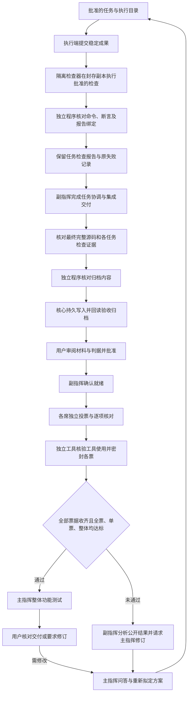

# 统一独立检查与加权验收

当前实现与判据版本：0.1.45 / v1。判据校准状态为 `unknown`。

## 检查与验收流程

执行过程的检查点使用稳定提交，不对仍在写入的文件生成通过结论。不同执行目录必须有明确的最终集成任务；不会通过拼接目录声称检查了完整项目。盲评前重新核对最终源码与封存副本一致，不会为了生成归档再次运行已经完成的检查。盲评后的主指挥整体功能测试保持独立阶段。

## 独立程序与归档职责

`cerulean-verifier.exe` 中的统一检查模块和验收模块通过不同的一次性请求运行。程序由构建摘要固定绑定，接收有界材料，不持有模型凭证、模型接口或通用文件接口。既有隔离运行器负责执行已批准的原生检查程序，统一检查模块负责核对返回的真实报告；它不把模型的“完成”说明当成测试结果。

任务检查记录绑定项目、方案版本、任务、尝试、检查操作、完整源码封存摘要、产物清单摘要、报告摘要、每项检查的命令及工具摘要。缺失结果、超时、非零退出码和断言不足分别保留未通过原因。经用户批准的复验使用对应的替代检查配置，原始失败证据保留。

检查报告向验收归档单向提交。独立程序先核对内容并返回摘要，核心在模型不可写的数据目录 `independent-check-archive` 完成持久写入与回读，随后才显示已归档。相同报告重复提交复用原记录；不同内容不可覆盖。中断遗留的相同待写入记录可完成发布，冲突记录则停止。归档缺失、损坏或不属于当前方案时，禁止开启或继续本轮评审与功能测试。

新数据启用 reader21 保护，旧程序拒绝读取，不能忽略新监督事件或加权判据后继续工作。备份同时保护检查归档的私有目录权限。

## 判据 v1

用户确认的初值：指令遵循 50%，独立检查结果 50%；单票至少 80%，全体平均至少 90%，同时保留全票通过。

- 指令分：模型对批准材料中每一项标准返回编号、是否对齐及支持该项的分片引用。编号与引用必须属于本轮材料；重复或越界引用拒绝。只有声明对齐且提供有效引用的项目计分；缺失、未对齐或无引用的项目不计分。
- 检查分：批准的检查项目中，通过真实结果与断言核验的项目比例；缺失项目保留在分母中。
- 单票综合分 = 指令分 × 50% + 检查分 × 50%。模型票或工具核验票未通过时不能通过单票门槛；观察到工具调用或请求、过程证据不足时，综合分为 0。
- 整体分使用完整参评名册的综合分平均值。零分票继续占据原席位，不缩小分母。只有全票通过、每席至少 80%、整体至少 90% 同时满足，才开放主指挥功能测试。
- 计算使用整数万分比，向下取整；不会因为显示四舍五入而越过阈值。

例：80 / 80 / 100 的各票都达到单票门槛，整体只有 86.66%，仍不通过。模型没有提供任何逐项核对，即便检查全通过，也只有 50%，不能通过。

这些数字是证据分，不是统计置信度、功能覆盖率或模型准确率。引用合法不能证明模型的语义判断正确，因此逐项核对仍明确标注为模型判断，真实检查和后续用户确认不能被省略。后续调整需版本化并绑定新轮次，已经批准或封票的轮次不追溯改分。

## 盲评边界与恢复

投票前不向模型发送总分、其他投票或通用文件接口。API、CLI、绑定桌面会话沿用各自的受限材料通道；模型推理仍可能联网。评分过程证据不充分时按未通过处理，不把“未观察到”冒充“已证明没有”。只有全部票据收齐，前端才展示逐票和整体分数。副指挥后续分析可以看到已揭晓的权重及扣分项。

取消、期限届满、交付改变、归档错误和核心重启保持各自状态，不自动重发评分。功能测试仍绑定原主指挥及当前交付。Qoder 监督建议在成功、工具切换、用户新消息或会话结束后失效；正常结束停用本任务 Hook，保留用户其他 Hook 设置，重启从原记录恢复监督状态。

真实 Codex/Qoder 评分、同会话配置恢复和跨接入完整业务联调仍须按专用环境验证，离线夹具通过不能替代这些结论。

## English overview

The pinned independent executable validates approved checkpoint results and the final integrated delivery before blind review. The existing isolated runner executes approved checks; the offline checker validates their reports. The host durably stores and rereads the validated archive before reporting archival success.

Policy v1 assigns 50% to criterion-specific model evidence and 50% to independently checked results. Every original seat must vote pass, meet 80%, and the full-roster average must reach 90%. Observed tool requests or unverifiable scoring traces yield zero effective weight without removing seats. Missing criterion evidence earns no credit. Scores remain sealed until all votes are collected.

These are uncalibrated evidence scores, not probabilities or test coverage. The chief's whole-project functional test remains locked until every gate passes; user delivery confirmation follows it. Reports, source identity and policy are immutable within a round. Reader21 prevents older cores from ignoring the new gates. Real provider and desktop-session verification is reported separately from offline regression results.
