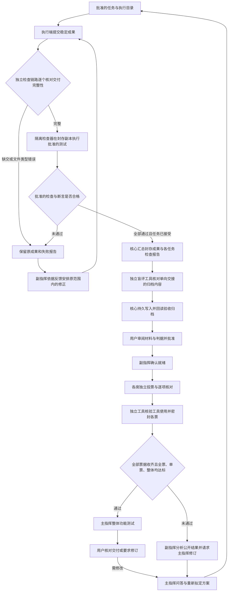

# 统一独立检查与加权验收

当前源码版本为 0.1.48。逐执行端返工和汇总交接改动正在回归验证，激活状态见 HANDOFF-LATEST.md。判据采用 v1，校准状态为 `unknown`。

## 检查与验收流程

每个执行端提交稳定成果后，独立检查链路核对交付文件、批准测试和真实断言。已完成回复中的漏交文件会保留为不完整交付，检查结果交副指挥安排补交或修正。返工创建新尝试，原失败报告继续保留。执行结果未知时，先核对原请求和进程终态。检查方案有疑议或需要改变任务范围时，由主指挥修订方案并提交用户审阅。

各执行端成果全部合格并完成任务接受后，核心从封存源码形成只读汇总副本。汇总核对路径归属、各项成果摘要、当前源码和原检查证据，发现冲突、漏项或检查后修改时停止交接。每个执行模型继续使用自己的工作目录，副指挥通过受限材料了解执行边界。已有显式集成任务的方案沿用其批准流程。

独立检查报告单向交给盲评工具核验和归档。全部票据达到判据后，主指挥才获得整体功能测试入口。多目录汇总副本使用专用普通 Windows 检查账户，源码权限为只读，测试临时目录可写。测试复用已批准的检查及有效复验标准，随后交用户核对最终产物。

## 独立程序与归档职责

检查与盲评验收现在是两个分别绑定构建摘要的程序：

- `cerulean-checker.exe` 是唯一新配置检查入口。主指挥在待批准方案中提供 Python 或 JavaScript 测试源码与断言编号；核心从本机已安装运行时中选择、固定路径和摘要，用户审阅完整测试后批准。独立程序在封存副本与原有隔离 Windows 账户中执行测试；核心负责 Job 时限、输出上限、取消和整个子进程树的收尾，再调用独立检查协议核对真实结果。
- `cerulean-verifier.exe` 负责接收并核验检查报告归档，以及源码分片、评分过程核验、票据与计票。检查程序不接受准备盲评、归档或计票操作，也不读取票据或总分。

新配置不再登记、选择或替换外部检查程序。旧登记和已批准方案保留供历史回读，更新配置后必须重新规划批准。测试代码、运行时摘要、断言与时限进入批准摘要；缺少源码、运行时或断言结果，及运行时改变、超时、输出超限、执行错误均不能通过。测试代码仍需人工审阅：独立进程不能自动证明测试充分或阻止故意编写的虚假断言；不得把模型自报或单纯文件存在当作行为测试。

首版支持已安装的 Node.js / Python 运行时，使用标准库和封存项目源码。检查器不会代替项目安装依赖，也不承诺覆盖任意技术栈。测试运行不继承工作台凭证或 PATH；隔离账户和 Job 不等于网络防火墙，批准前必须审阅测试代码的网络、文件与进程行为。独立检查程序本身没有模型调用、凭证存储或投票接口。

任务检查记录绑定项目、方案版本、任务、尝试、检查操作、完整源码封存摘要、产物清单摘要、报告摘要、每项检查的命令及工具摘要。缺失结果、超时、非零退出码和断言不足分别保留未通过原因。经用户批准的复验使用对应的替代检查配置，原始失败证据保留。

检查报告向验收归档单向提交。独立程序先核对内容并返回摘要，核心在模型不可写的数据目录 `independent-check-archive` 完成持久写入与回读，随后才显示已归档。相同报告重复提交复用原记录；不同内容不可覆盖。中断遗留的相同待写入记录可完成发布，冲突记录则停止。归档缺失、损坏或不属于当前方案时，禁止开启或继续本轮评审与功能测试。

独立测试方案启用 reader22 保护（原有加权判据保留 reader21），旧程序拒绝读取，不能忽略新监督事件或加权判据后继续工作。备份同时保护检查归档的私有目录权限。

## 判据 v1

用户确认的初值：指令遵循 50%，独立检查结果 50%；单票至少 80%，全体平均至少 90%，同时保留全票通过。

- 指令分：模型对批准材料中每一项标准返回编号、是否对齐及支持该项的分片引用。编号与引用必须属于本轮材料；重复或越界引用拒绝。只有声明对齐且提供有效引用的项目计分；缺失、未对齐或无引用的项目不计分。
- 检查分：批准的检查项目中，通过真实结果与断言核验的项目比例；缺失项目保留在分母中。
- 单票综合分 = 指令分 × 50% + 检查分 × 50%。模型票或工具核验票未通过时不能通过单票门槛；观察到工具调用或请求、过程证据不足时，综合分为 0。
- 整体分使用完整参评名册的综合分平均值。零分票继续占据原席位，不缩小分母。只有全票通过、每席至少 80%、整体至少 90% 同时满足，才开放主指挥功能测试。
- 计算使用整数万分比，向下取整；不会因为显示四舍五入而越过阈值。

例：80 / 80 / 100 的各票都达到单票门槛，整体只有 86.66%，仍不通过。模型没有提供任何逐项核对，即便检查全通过，也只有 50%，不能通过。

这些数字是证据分，不是统计置信度、功能覆盖率或模型准确率。引用合法不能证明模型的语义判断正确，因此逐项核对仍明确标注为模型判断，真实检查和后续用户确认不能被省略。后续调整需版本化并绑定新轮次，已经批准或封票的轮次不追溯改分。

## 盲评边界与恢复

投票前不向模型发送总分、其他投票或通用文件接口。API、CLI、绑定桌面会话沿用各自的受限材料通道；模型推理仍可能联网。评分过程证据不充分时按未通过处理，不把“未观察到”冒充“已证明没有”。只有全部票据收齐，前端才展示逐票和整体分数。副指挥后续分析可以看到已揭晓的权重及扣分项。

取消、期限届满、交付改变、归档错误和核心重启保持各自状态，不自动重发评分。功能测试仍绑定原主指挥及当前交付。Qoder 监督建议在成功、工具切换、用户新消息或会话结束后失效；正常结束停用本任务 Hook，保留用户其他 Hook 设置，重启从原记录恢复监督状态。

真实 Codex/Qoder 评分、同会话配置恢复和跨接入完整业务联调仍须按专用环境验证，离线夹具通过不能替代这些结论。

## English overview

Two separately pinned programs now serve different roles. `cerulean-checker.exe` is the single entry for new objective tests: the chief proposes reviewed Python/JavaScript source and assertion IDs; the host binds an installed runtime and the complete recipe before user approval. Tests run in the sealed task snapshot and existing isolated Windows account, inside a host-owned Job with deadline/output limits and descendant cleanup. The checker validates the resulting evidence. `cerulean-verifier.exe` accepts the one-way reports and handles review materials, tool audits and voting. The checker protocol cannot count votes. The host durably stores and rereads the validated archive.

Each executor's stable submission first undergoes completeness checks and its approved objective tests. Failed results return to the deputy for concrete corrections within the approved scope. A fresh attempt preserves the original submission and failure evidence. Changes to tests or scope go through chief planning and user review. Unknown execution outcomes require reconciliation.

After all submissions pass and are accepted, the core assembles their authenticated snapshots and reports into a read-only delivery. Ownership conflicts, missing files and post-check changes block handoff to the blind-review verifier. Executors keep their assigned directory boundaries. Existing explicit integration plans retain their approved path. Whole-project functional testing opens after blind review passes and uses the approved effective suites, followed by user delivery confirmation.

Policy v1 assigns 50% to criterion-specific model evidence and 50% to independently checked results. Every original seat must vote pass, meet 80%, and the full-roster average must reach 90%. Observed tool requests or unverifiable scoring traces yield zero effective weight without removing seats. Missing criterion evidence earns no credit. Scores remain sealed until all votes are collected.

These are uncalibrated evidence scores, not probabilities or test coverage. The chief's whole-project functional test remains locked until every gate passes; user delivery confirmation follows it. Reports, source identity and policy are immutable within a round. Reader22 protects the approved-test recipe semantics; reader21 still protects earlier weighted-review gates. Real provider and desktop-session verification is reported separately from offline regression results.
