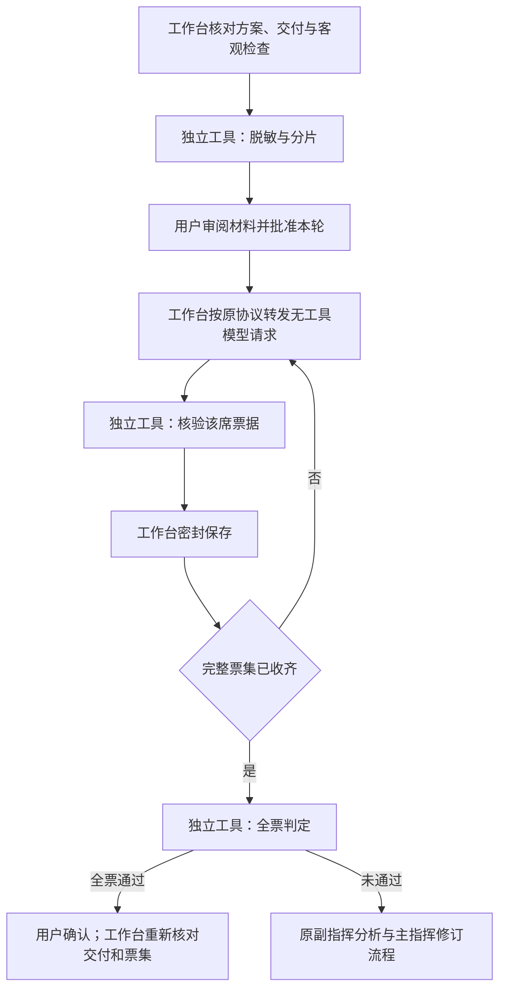

# 工作台绑定的独立验收工具 / Bound independent verifier

自 0.1.39 起，工作台附带 `cerulean-verifier.exe`。源码位于本仓库的 `crates/domain/src/independent_verifier/`、同名模块和 `crates/domain/src/bin/cerulean-verifier.rs`；宿主接线位于 `crates/core/src/independent_verifier.rs`。它与工作台一起构建、分发，位于完整程序目录，不放在编程项目目录。新项目目录初始为 `D:\test\coding`，用户可在关联前修改；不会自动迁移既有项目。

Starting with 0.1.39, `cerulean-verifier.exe` ships with the workbench. Its sources live in this repository, under the domain verifier module and binary, with host integration in the core verifier module. It belongs beside the workbench binaries, outside coding projects. New project registration starts with `D:\test\coding`; the path remains editable and does not relocate existing projects.

## 实际职责 / Responsibilities

- **准备材料：** 对核心核对过的源码内容、需求和标准执行既有脱敏与分片算法，不接收源文件路径，不执行源码、钩子或插件。完整材料必须通过容量与格式检查。
- **独立核票：** 每个回包单独核对批准席位、模型名称规则和引用。核验单票的请求不含其他票据。
- **统一计票：** 收齐完整名单后才检查唯一席位、有效票据和全票门槛。缺票、重复、错误身份或格式错误不产生通过结论；最终用户确认时再次核验完整票集。
- **保持原验收流程：** 工作台保留客观检查证据、批准、网络调用、密封票库、恢复及用户最终确认。独立工具不持有密钥、不联网、不写账本，也不能批准或执行项目任务。项目功能测试仍由批准方案中的测试程序完成，盲评不替代客观测试。

- **Material preparation:** Applies the existing redaction and fragmentation algorithm to host-validated contents, requirements and criteria. It receives no source paths and executes no project code, hooks or plugins. Complete materials must satisfy existing size and format checks.
- **Individual ballot checks:** Validates the approved seat, allowed model identity and citations. A single-ballot request contains no other ballots.
- **Unanimous tally:** Evaluates the complete, distinct roster only after all ballots arrive. Missing, duplicate, malformed or mismatched ballots cannot pass. Final user confirmation rechecks the complete ballot set.
- **Existing acceptance remains:** The workbench owns objective evidence, authorization, network calls, sealed records, recovery and final user confirmation. The tool has no credentials, network calls or ledger writes, and cannot authorize or execute coding tasks. Approved project test programs still perform functional checks; voting does not replace them.

## 固定绑定与进程边界 / Binding and process boundary

封包先构建独立工具，将它的 SHA-256 编入 GUI 和核心。正式运行只查找程序同目录中的固定文件名；文件缺失、摘要改变或响应版本／请求摘要不符时停止，不提供自选路径或自动回退。设置页只读展示绑定状态；项目专用测试程序保留在高级配置中。

The package build creates the verifier first and embeds its SHA-256 in the GUI and core. Production accepts only the fixed sibling filename. Missing or changed bytes, version mismatch or a response for a different request stop the operation. The UI exposes a read-only binding; project-specific test programs remain advanced configuration.

请求和响应通过匿名管道传递，每次最多 1 MiB，最长 10 秒。沿用 Windows Job 进程树管理，清空继承环境中的密钥和注入设置，结束后确认进程退出。工具是受信任的本地组件，与宿主使用同一账户；进程分离不被描述为新的操作系统账户隔离。它不接受路径、通用文件工具、模型接入或账本修改指令。直接运行它得到的离线结果没有工作台授权效力。

Requests and replies use anonymous pipes, bounded to 1 MiB and 10 seconds. Existing Windows Job ownership manages process lifetime with a restricted environment and confirmed cleanup. This trusted component uses the host account; a separate process is not a new OS-account isolation boundary. Its protocol accepts no paths, generic file tools, model access or ledger mutations. Running it directly cannot create workbench approval.

原有材料上限、全票要求、用户确认及不自动重发规则不变。脱敏不能证明消除任意暗号；独立 EXE 也不证明模型推理质量。新增程序改变发行资源布局，从旧版使用完整安装器升级；旧签名专用的七文件重封包脚本拒绝新布局，常规构建使用 `node scripts/desktop.mjs package`。

Existing material bounds, unanimity, final user confirmation and no automatic retries remain. Redaction cannot prove the absence of arbitrary covert signals, and a separate executable is not evidence of model quality. The added resource requires full-installer upgrades from the old layout. The historical seven-file signing helper rejects the new layout; normal builds use `node scripts/desktop.mjs package`.
