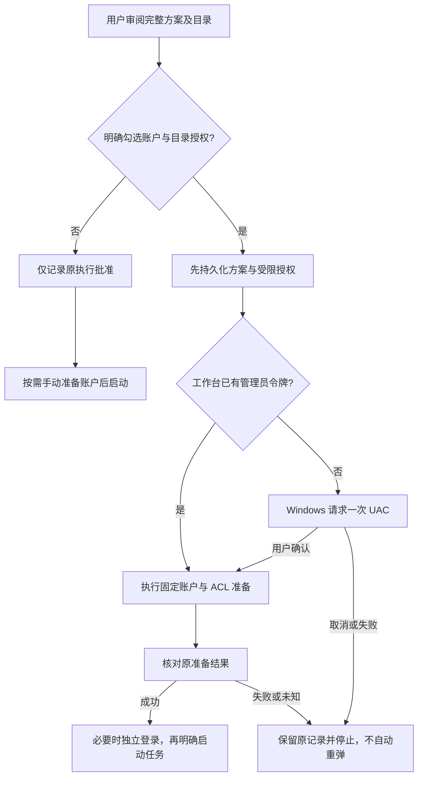
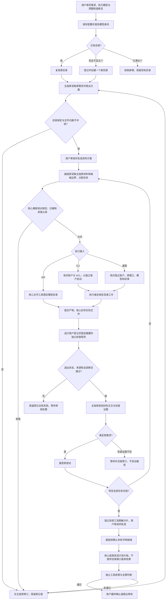

> 2026-11-04历史资料整理说明。原始本地证据已按维护者要求提炼归档，历史结论和边界保存在维护者本地的 docs/build-cache 文档目录。文中原路径用于识别历史记录。

# 角色目录、五个执行目录与独立检查

本页描述 0.1.34 发布基线之后的开发改动。冻结安装包不会因修改源码而自动更新。

## 工作目录

```text
项目主指挥目录/                  独立于共享目录和核心数据
  requirements/<配置摘要>.json   原需求，不覆盖旧版本
  plans/<方案摘要>.json          主指挥方案
  reviews/<审阅包摘要>.json      已封存产物正文和独立检查证据

副指挥与执行端共享总目录/
  executors/
    <模型身份摘要 A>/            模型 A 的固定工作目录
    <模型身份摘要 B>/            模型 B 的固定工作目录
    ...                         每个项目最多五个

核心数据目录/                    由工作台管理，不授予执行账户访问
  worker-directories/            持久目录登记
  worker-accounts/               账户 SID、目录绑定和 DPAPI 密文
  worker-account-setup/          每次显式 UAC 设置的原始回执
  workflows/                    原尝试、日志、封存副本和验收账本
```

保存新执行模型配置时分配目录。API 以接入目标及模型 ID 区分；CLI 还绑定提供方及规范程序路径；桌面接入以应用和观察到的模型名称区分。调整请求上限等运行参数不会占用新目录。切回已有身份复用原目录和产物，第六个身份在分配前被拒绝。

目录注册先写持久意图，再创建目录并提交登记。中断、未登记目录、链接或登记损坏会阻止继续分配，保留原事务供核对，不自动接管、清空或创建替代目录。五个目录是持久数量上限，不代表五个并发任务。

不同模型目录之间不会自动复制或合并文件。同一模型的后续任务可以接着使用原文件；切换模型后，只能看到新模型自己目录中的输入。跨端协作应明确接口与任务状态，不以复制其他执行端源码扩大权限；其他端源码只在批准的评审中通过只读片段提供。固定模型目录模式不与“每次尝试创建 Git 工作树”模式混用。

正常执行必须绑定模型目录。没有绑定的旧方案仍可读取历史和核对原结果，但不能启动或恢复派发；需启用角色隔离，重新规划并由用户批准。API 文件工具只在绑定目录内操作；CLI／桌面执行保持已有独立 Windows 账户及项目 ACL，不因进入评审放宽权限。

方案按声明的源码／交付文件路径检查归属：不同模型不能负责相同路径，也不能通过大小写或父子路径重叠规避检查。当前按完整文件保守分区，不支持两个执行端分改同一文件的不同代码行。同一模型可以顺序处理自己的文件，既有目录租约防止并发占用；工作台不以源码内容相似度推断任意复制文件的语义归属。

主指挥规划与副指挥分配的新上下文带有 `executionBoundaries`：任务、模型身份、绑定目录、负责文件、正常访问范围及只读评审范围。分配回包应用前重建并核对边界；形成方案、批准和实际派发也检查冲突，提示文字本身不授予权限。冲突须交主指挥修订并重新批准，不能由副指挥扩大目录或临时共享源码。

副指挥通过核心取得主指挥原需求和方案的只读内容。核心核对原配置、方案摘要和实际文件，副指挥没有修改这些材料的操作。执行端的文件工具、进程工作目录、产物观察与验收快照都使用任务批准时绑定的模型子目录。

## 实际流程

0.1.41 起，方案审阅可勾选“隔离账户创建、项目目录权限设置”，默认关闭。核心将授权与原方案、配置、目录及固定脚本绑定后才发起一次管理准备；执行模型仍是普通账户。已提权宿主使用已有令牌，否则请求一次 Windows UAC，由用户本人确认。失败、取消、丢回执、重复批准及重开均不自动重弹。首次授权启用 reader20；旧版本不能再读取该数据目录。未授权时保留原批准格式，不会自动提权。



已批准但尚未启动的方案可核对准备结果，或由用户明确点击账户设置按钮发起新的一次；原设置未决时仍阻止重复操作。登录不属于管理员授权。任务开始后，账户准备和登录入口受运行锁约束，不可借授权改变正在执行的目录权限。



运行中可以修改后续要使用的模型，并保存为本机“下一版草稿”。此操作不会更换正在执行的模型、重绑目录或发送请求。当前任务处理完毕后，请求方案修订，再载入草稿、保存配置、重新规划和批准。

## CLI 和桌面账户

1. 保存启用了主指挥独立目录的新配置。
2. 点击“设置或补齐独立账户”，完成本次 UAC。每个目录绑定不同的普通本地账户，现有账户按原 SID 复用。
3. Codex 使用“打开独立登录”；桌面接入使用“打开独立应用”。在对应窗口内登录并核对模型目录。已有日常账户的登录不会复制过去。
4. 桌面应用重新关联新账户下的聊天，再规划和批准任务。安装在原用户私有目录、对独立账户不可读取的应用需要先为对应账户安装。

独立账户的登录密码由系统随机生成，以工作台用户的 Windows DPAPI 加密保存。密码不写入命令行或回执。创建的进程先保持挂起，核对实际账户后加入由核心持有的 Windows Job，再开始运行。不能证明账户或目录权限时停止，不回退到宿主账户。

账户 SID 必须匹配，进程令牌也不能包含管理员组。桌面进程的账户检查在专用短线程中使用该执行账户的身份查询，不改变工作台主线程身份。窗口读取器仅申请读取程序路径和创建时间所需的权限，不读取目标进程内存。UAC 准备目录只允许宿主、SYSTEM 和管理员访问，脚本与配置文件在提权前锁定，直到原调用结束。

UAC 取消或设置失败不会自动重弹。再次点击按钮属于新的显式设置操作；结果未明的原事务必须先核对。设置完成不等于已登录供应商，也不授权模型任务。

**隔离范围是工作台管理的项目资料。** ACL 保护主指挥目录、核心数据、共享资料及其他执行目录。Windows 的系统文件、公开安装依赖和该账户自己的系统配置目录仍按操作系统权限访问。这不是全盘文件沙箱，也不屏蔽桌面应用自身的网络能力。API 文件工具则只能访问绑定的模型目录。

## 独立检查怎样判定

独立检查不是另一个 AI。用户先登记可信程序及其输入脚本，工作台固定其文件摘要、参数和权限范围，在封存的项目副本上运行它，记录真实退出码、超时、进程树和原始输出。执行模型不能改写工作台中的检查记录。

程序和来源的固定摘要仍使用规范路径保存。启动本地检查器时，只有确认普通 Windows 路径仍指向同一文件或目录，才转换启动路径，避免 Windows PowerShell/.NET Framework 无法处理扩展路径造成的初始化或工作目录错误。不会因此跳过摘要核对、放宽环境继承或重跑原检查。

新角色隔离配置的每项检查必须声明至少一个预期断言 ID。例如 `normal`、`invalid-input`。检查器的标准输出使用下面的 JSON，普通诊断信息应写标准错误：

```json
{
  "schemaVersion": 1,
  "assertions": [
    {"id": "normal", "passed": true, "detail": "2 + 3 = 5"},
    {"id": "invalid-input", "passed": true, "detail": "空输入被明确拒绝"}
  ]
}
```

核心要求断言 ID 与批准清单精确匹配，不接受缺项、重复、额外项、空证据说明或失败断言。退出码 0 配合空脚本或只打印“成功”也不会通过；报告格式错误会作为已观察到的检查失败保留，不冒充进程仍在运行。

检查通过后，主指挥还要审阅原需求、方案、封存产物的 UTF-8 正文和结构化检查报告。检查通过不替代语义审阅。正文累计上限为 24 KiB，整个管理上下文上限为 64 KiB；二进制或超出容量时明确停止收口，需要拆分任务或另行接入相应审阅方式，不截断后自动接受。

断言协议证明检查程序报告了哪些检查，不能证明任意脚本的断言真实、全面或没有遗漏。检查程序仍是用户登记的可信本地程序；快照和 Windows Job 本身不构成该程序的 OS 沙箱。

旧批准、旧配置和历史失败保持原格式及原结论。旧项目需显式启用目录隔离、配置断言并重新批准，不能把历史记录自动改成新规则下的通过证据。

## 验证与源码入口

唯一开发目录：`D:\test\CeruleanLonging-dev`。旧审查基准和冻结包源码保持不变。开发基线来自 1,212 个已发布 Git blob 的逐个核对。765 已取得真实上游提交 `2ef805dd`，核对整棵文件树相同后接入开发分支；未提交文件逐字节保持。原重建根只保留在本地归档分支，不用于发布。

本轮证据保存在 `D:\test\CeruleanLonging\reports\workspace-repair-764`。账户访问探测使用本轮新建的普通账户和合成目录；React 交互测试使用记录命令的本地接收端；模型回复模拟测试不会调用真实供应商。账户隔离测试不能代替未执行的真实供应商登录或第三方桌面版本兼容性验收。

## 审查问题与修复对应

| 原因 | 本轮处理 |
| --- | --- |
| 历史源码、发布快照与开发入口混杂 | 新开发集中到 `CeruleanLonging-dev`，旧源码和冻结包保持原身份 |
| 所有执行者使用项目总目录，缺少持久模型身份绑定 | 保存配置时登记最多五个模型目录；批准、派发、产物与恢复均绑定原目录 |
| CLI 工作目录和写沙箱不能单独约束读取 | 独立普通 Windows 账户与目录 ACL；账户不符、权限无法确认时拒绝派发 |
| 运行中修改配置可能引发模型或目录身份混淆 | 只保存下一版草稿，当前尝试不变；新方案须重新批准 |
| 独立检查只依据进程结果，无法要求明确检查项 | 新隔离项目必须声明断言 ID；缺失、重复、失败或格式错误都不能通过 |
| 主指挥只收到证据摘要，不能据此直接审阅实际内容 | 从原成功检查的封存副本生成正文审阅包，并在接受前重新核对 |
| 新隔离配置未被原运行入口识别为需绑定的配置 | 运行校验同时绑定主指挥目录配置摘要，完整任务链回归覆盖 |

764 的 Windows 账户测试覆盖自己的文件读写、对其他目录的枚举/写入拒绝、已知文件完整路径的读取拒绝、正确进程 SID 与错误账户拒绝，以及产品 UAC 设置流程复用原账户。其两个专用测试账户及密码密文、用户配置目录已退役，测试证据保留。

## 765：真实程序兼容性补测与 OMP 修正

Codex `0.166.0-alpha.5.1` 的真实程序已在新普通账户中完成本地协议握手，确认没有继承宿主登录，没有创建模型任务，并正常关闭。只复制了原程序文件用于访问权限测试，没有复制用户配置。实际使用时，程序本体及依赖也必须能够被对应执行账户读取。

OMP 的祖先配置检查原先使用宿主权限，会把共享总目录中已被 ACL 隔离的 `.git`、`AGENTS.md` 等视为可读取的配置，导致独立账户路线误拒绝。现在仍先由宿主检查路径、链接与目录归属，再在专用线程以实际执行账户检查配置可访问性。只有该账户明确收到访问拒绝的标记才会跳过；任何可读取的 `.env`、规则文件或配置目录仍阻止启动。宿主模式保留原先的严格规则。

真实 OMP 补测验证了共享需求文件读取被拒绝、自己目录中的 `.env` 仍被拦截、正常协议协商和状态读取、退出码 0 与进程树清零。仅使用合成凭证，协议请求限于一次 `negotiate_protocol` 和一次 `get_state`，没有发送模型任务。两项原配置拦截回归也通过。

765 历史记录：WorkBuddy `5.8.3.0` 首次在独立账户中启动，其窗口身份和 SID 核对成功；第二次启动进入自身更新流程，没有完成独立登录、关联或编程验收。原失败记录保留。

2026-11-03 更新：用户因内存占用要求移除 WorkBuddy 支持，766 登录后的实测已终止，未发送编程任务。当前开发版本不再提供该接入，也不再继续此项实测；旧记录保持可读，详见 [WorkBuddy 接入移除](WORKBUDDY-RETIREMENT.md)。Qoder 的真实独立账户应用流程仍是单独的兼容性项目。

独立账户并不禁用第三方应用自己的联网、托盘或更新能力。关闭窗口未必退出后台进程；产品仍持有原进程树与账户绑定，不能据窗口消失自动换绑任务。一次性桌面探测只清理自己创建且没有业务任务的进程，不操作日常应用。

765 的回执保存在 `D:\test\CeruleanLonging\reports\workspace-followup-765`，原失败与后续修正分开保存。764 已通过的功能、UI、断言及恢复测试沿用原记录，没有重新跑全量套件。本轮没有更新已发布安装包，也没有向 GitHub 写入开发代码。
